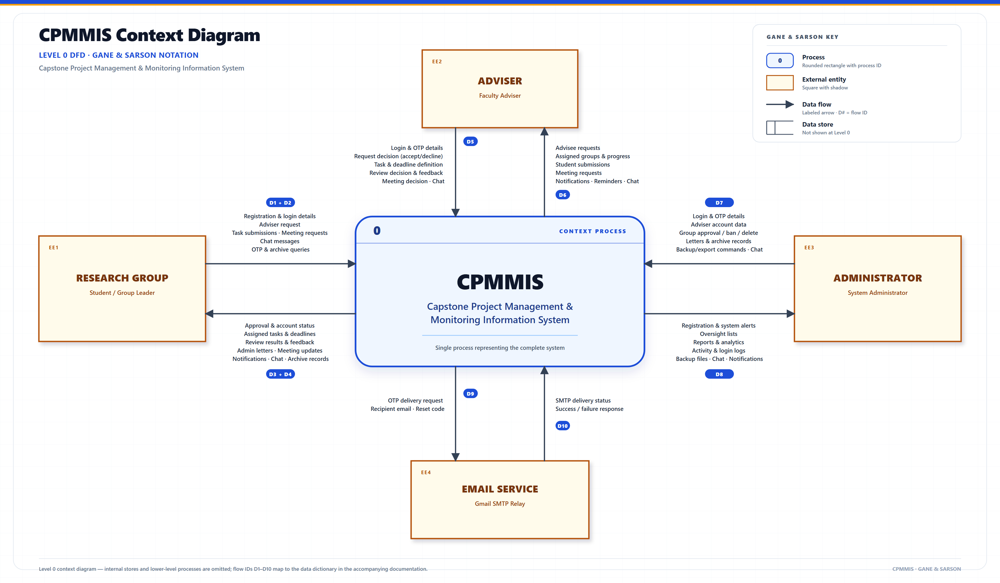
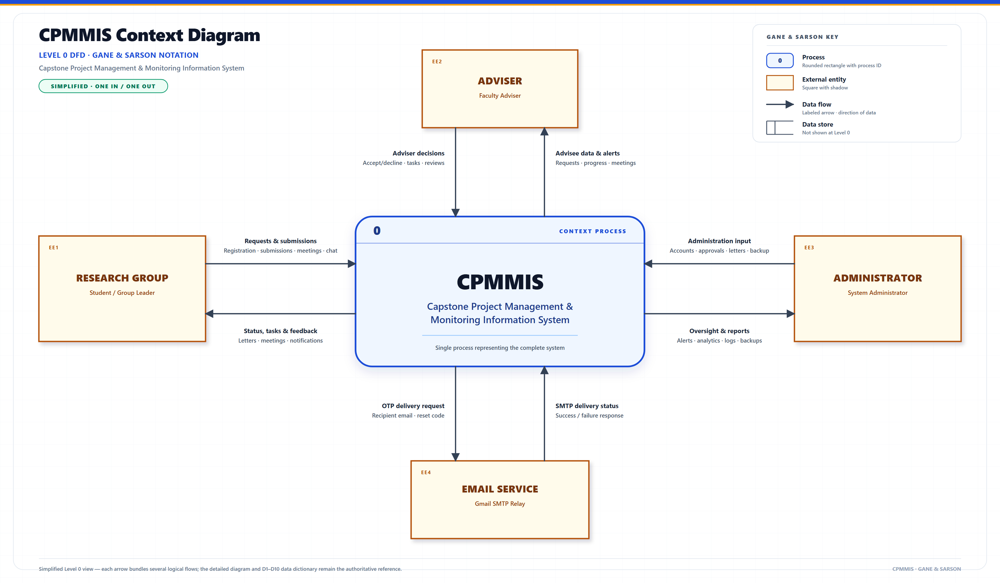

# CPMMIS — Context Diagram (Level 0)

**Gane & Sarson notation**

> Editable source: [`cpmmis-dfd-context.svg`](cpmmis-dfd-context.svg)  
> Rendered image: [`cpmmis-dfd-context.png`](cpmmis-dfd-context.png)  
> PDF export: [`cpmmis-dfd-context.pdf`](cpmmis-dfd-context.pdf)  
> Word export: [`cpmmis-dfd-context.docx`](cpmmis-dfd-context.docx)  
> Full report PDF: [`cpmmis-dfd-context-report.pdf`](cpmmis-dfd-context-report.pdf)

Each arrow on the **detailed diagram** carries a **D-number** that matches the
data-flow table below. Arrows that bundle several logical flows show a combined badge
(for example **D1 + D2**), so the picture and the data dictionary stay in sync.

| Version | PNG | SVG | PDF |
|---|---|---|---|
| Detailed (D1–D10) | [`cpmmis-dfd-context.png`](cpmmis-dfd-context.png) | [`cpmmis-dfd-context.svg`](cpmmis-dfd-context.svg) | [`cpmmis-dfd-context.pdf`](cpmmis-dfd-context.pdf) |
| Simplified (one in / one out) | [`cpmmis-dfd-context-simple.png`](cpmmis-dfd-context-simple.png) | [`cpmmis-dfd-context-simple.svg`](cpmmis-dfd-context-simple.svg) | [`cpmmis-dfd-context-simple.pdf`](cpmmis-dfd-context-simple.pdf) |

## Purpose

This Level 0 diagram establishes the **system boundary** for the Capstone Project
Management & Monitoring Information System (CPMMIS). A single process, **0**, represents
the entire system. Everything outside that process is an external entity that supplies
data to, or receives data from, CPMMIS.

The diagram intentionally does **not** show internal processes or data stores. Those are
introduced in the Level 1 decomposition.

## Gane & Sarson notation

| Symbol | Meaning | Use in this diagram |
|---|---|---|
| Rounded rectangle with an ID compartment | Process | Process **0** — the complete CPMMIS |
| Square with a shadow | External entity | Research Group, Adviser, Administrator, Email Service |
| Labeled arrow | Data flow | Data or materials exchanged with an external entity; the D-number links to the data dictionary. |
| Open-ended rectangle | Data store | Not shown at Level 0 |

## External entities

| ID | External entity | Type | Description |
|---|---|---|---|
| EE1 | **Research Group** | Human actor | The student group leader/group account that registers, requests an adviser, submits requirements, requests meetings, chats, and downloads records. |
| EE2 | **Adviser** | Human actor | The faculty adviser who accepts/declines advisees, defines tasks and deadlines, reviews submissions, handles meetings, and communicates with groups. |
| EE3 | **Administrator** | Human actor | The system administrator who manages accounts, approves groups, posts letters, maintains the archive, reviews reports and logs, and runs backups. |
| EE4 | **Email Service** | External system | The Gmail SMTP relay used to deliver password-reset OTP messages. |

## Data flows

Each arrow in the diagram may carry more than one logical data flow; the table separates
them for clarity.

| ID | From → To | Trigger | Data flow | Contents |
|---|---|---|---|---|
| D1 | Research Group → CPMMIS | Group registers, signs in, requests an OTP, requests an adviser, or searches the archive. | Registration, login & service requests | Group name, leader name/email, project title, password, login credentials, OTP request, adviser request, archive search criteria. |
| D2 | Research Group → CPMMIS | Group submits a task/chapter, requests a meeting, or sends a chat message. | Academic workflow input | Task/chapter submission (PDF and task reference), meeting request (preferred date/time and agenda), and chat messages. |
| D3 | CPMMIS → Research Group | Registration/approval, adviser assignment, task creation, submission review, or letter posting is processed. | Account, task & review output | Pending/approved/declined status, adviser assignment/decision, assigned tasks and deadlines, review results and feedback, admin letters. |
| D4 | CPMMIS → Research Group | A meeting is confirmed/rescheduled, a reminder/notification is sent, chat is relayed, or an archive record is served. | Coordination output | Meeting confirmation/reschedule, reminders, notifications, chat messages, and archive records/downloads. |
| D5 | Adviser → CPMMIS | Adviser signs in, accepts/declines a request, defines/edits a task, reviews a submission, decides a meeting, or chats. | Decisions & task setup | Login/OTP details, adviser-request decision (accept/decline), task and deadline definition (including attachment), submission review decision and feedback, meeting decision, chat messages. |
| D6 | CPMMIS → Adviser | A group request, submission, meeting request, or chat/notification event reaches the adviser. | Advisee & submission data | Incoming advisee requests, assigned groups and progress, student submissions, meeting requests, notifications/reminders, chat messages. |
| D7 | Administrator → CPMMIS | Administrator signs in, manages accounts, approves/bans/deletes a group, posts a letter, uploads archive records, runs backup/export/maintenance, or chats. | Administration & maintenance input | Login/OTP details, adviser account data, group approval/ban/delete actions, letters (title, description, PDF), archive records, backup/export/maintenance commands, chat messages. |
| D8 | CPMMIS → Administrator | A registration/system event occurs, a report or log is viewed, a backup completes, or a chat/notification reaches the administrator. | Oversight & operational output | Registration and system alerts, group/adviser/submission oversight lists, reports and analytics, activity and login logs, backup/export files, notifications, chat messages. |
| D9 | CPMMIS → Email Service | A user requests a password-reset OTP. | OTP delivery request | Recipient email address, subject, and password-reset code. |
| D10 | Email Service → CPMMIS | The SMTP relay returns the result of an OTP delivery attempt. | SMTP delivery status | Success, failure, or error response from the SMTP relay. |

## Simplified view

For presentations and quick review, the simplified diagram keeps **one inbound and one
outbound flow per external entity**. Each arrow bundles the detailed flows from the
table above.

> Editable source: [`cpmmis-dfd-context-simple.svg`](cpmmis-dfd-context-simple.svg)  
> PDF export: [`cpmmis-dfd-context-simple.pdf`](cpmmis-dfd-context-simple.pdf)

| Simplified flow | Direction | Bundles |
|---|---|---|
| Requests & submissions | Research Group → CPMMIS | D1 + D2 |
| Status, tasks & feedback | CPMMIS → Research Group | D3 + D4 |
| Adviser decisions | Adviser → CPMMIS | D5 |
| Advisee data & alerts | CPMMIS → Adviser | D6 |
| Administration input | Administrator → CPMMIS | D7 |
| Oversight & reports | CPMMIS → Administrator | D8 |
| OTP delivery request | CPMMIS → Email Service | D9 |
| SMTP delivery status | Email Service → CPMMIS | D10 |

## Scope notes

- **Login and OTP flows** are shown for all three human actors because each role can
  authenticate and reset a password through the system.
- **Files are data flows, not data stores, at this level.** Submitted PDFs, admin letters,
  and archive documents cross the system boundary as flows; their internal storage is a
  Level 1 concern.
- **Email Service** is modelled as an external system because OTP delivery is the only
  outbound email integration in the current implementation.
- **Panelist** is not shown as an external entity. The current schema retains a legacy
  `submission_type = 'panel'` value and the reports filter lists a `panelist` option, but
  there is no active panelist account table or panel workflow in the current database.

## Suggested Level 1 decomposition

When the context diagram is decomposed, process 0 can be split into:

1. **1.0 Account & Access Management** — registration, login, OTP/password reset.
2. **2.0 Advising & Group Matching** — adviser requests, accept/decline, group assignment.
3. **3.0 Task & Submission Management** — tasks, deadlines, PDF submissions, review and feedback.
4. **4.0 Meeting Management** — meeting requests, confirmation, rescheduling, reminders.
5. **5.0 Communication & Notifications** — chat, notifications, admin letters.
6. **6.0 Archive & Reporting** — capstone archive, search, reports, activity/login logs.
7. **7.0 Administration & Maintenance** — adviser/group administration, backup, export, system settings.

## Source basis

Derived from the live CPMMIS database schema (`schema_full.sql`) and the implemented
controllers under `backend/auth`, `backend/groups`, `backend/advisers`, `backend/admin`,
`backend/chat`, `backend/notifications`, `backend/archive`, and `backend/system`.
