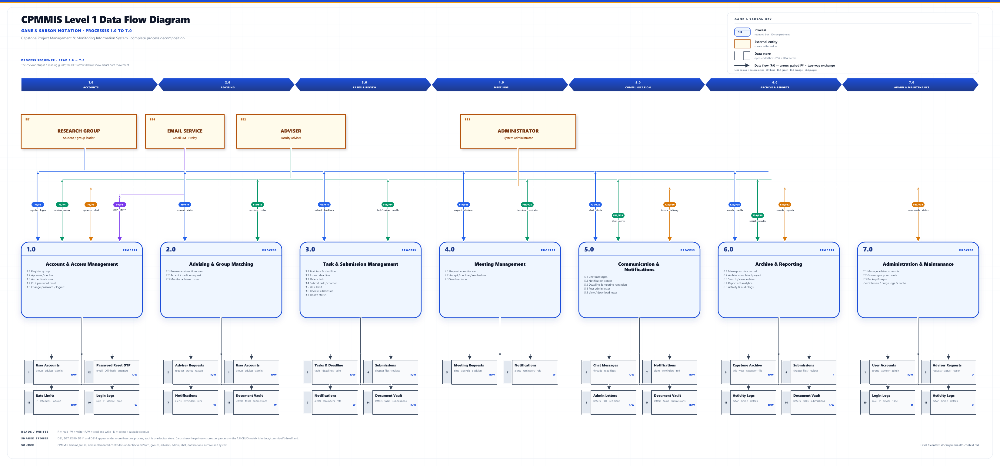

# CPMMIS — Level 1 Data Flow Diagram and Process Specification

**Gane & Sarson notation · processes 1.0 to 7.0**



> Editable source: [`cpmmis-dfd-level1.svg`](cpmmis-dfd-level1.svg)  
> Rendered image: [`cpmmis-dfd-level1.png`](cpmmis-dfd-level1.png)  
> Level 0 context: [`cpmmis-dfd-context.md`](cpmmis-dfd-context.md)

This document decomposes process **0** of the Level 0 context diagram into the
seven top-level processes of the Capstone Project Management & Monitoring
Information System (CPMMIS). It defines every subprocess, external data flow,
logical data store, business rule, state transition, and exception path visible
in the implemented system.

---

## 1. Purpose and scope

The Level 1 DFD shows **how data moves inside CPMMIS**:

- **What** enters the system from each external entity.
- **Which process** transforms it.
- **Which logical data store** is read, written, or deleted.
- **What** is returned to the external entity.

The model covers the implemented account, advising, task, submission, meeting,
communication, archive, reporting, and maintenance workflows. It does not model
the public marketing pages, the database engine itself, or third-party services
other than the Gmail SMTP relay used for OTP delivery.

### Reading the diagram

- The **blue chevron strip** at the top is a reading guide for the business
  sequence **1.0 → 7.0**. It is not a data flow.
- The **arrows** below the actors are the actual data flows. Each actor drop is
  **two-way**: the downward arrowhead is data going into the process, and the
  small upward arrowhead at the trunk is data going back to the actor.
- Flow identifiers are paired: **odd F-numbers are inbound** to the process and
  the **next even F-number is the corresponding outbound** flow. For example,
  **F1** is Group → 1.0 and **F2** is 1.0 → Group.
- **Store arrows** show process access. The `R`, `W`, `R/W`, and `D` tags on each
  store card give the access mode:
  - **R** — read only
  - **W** — write / append
  - **R/W** — read and write
  - **D** — delete or cascade cleanup
- Store cards show the **primary** stores for each process. The complete
  process–store matrix is in [section 8](#8-processstore-crud-matrix); shared
  stores (DS1, DS7, DS10, DS11, DS14) appear under more than one process but are
  the same logical store.

---

## 2. Gane & Sarson notation key

| Symbol | Gane & Sarson meaning | Use in this model |
|---|---|---|
| Rounded rectangle with an ID compartment | **Process** | One of the seven numbered processes, `1.0`–`7.0`, with its subprocesses listed inside. |
| Square with a drop shadow | **External entity** | A human actor or external system outside the CPMMIS boundary. |
| Open-ended rectangle with a numbered left compartment | **Data store** | A logical collection of data, mapped to one or more physical tables or an upload folder. |
| Labeled directional arrow | **Data flow** | Data or materials exchanged between an external entity and a process. Each arrow carries an `F#` badge. |

The Level 1 diagram deliberately omits control flows, triggers, and user-interface
navigation. A trigger is described in the process specification, not drawn as an
arrow. This keeps the diagram a **data** flow diagram rather than a flowchart.

---

## 3. External entities

| ID | External entity | Type | Role in CPMMIS | Inbound flows | Outbound flows |
|---|---|---|---|---|---|
| **EE1** | **Research Group** | Human actor | Student group leader/group account. Registers, requests an adviser, submits chapters, requests consultations, chats, reads letters, and downloads archive records. | F1, F9, F15, F17, F21, F27 | F2, F10, F16, F18, F22, F28 |
| **EE2** | **Adviser** | Human actor | Faculty adviser. Accepts advisees, posts tasks and deadlines, reviews submissions, decides meetings, chats, and searches the archive. | F3, F11, F13, F19, F23, F29 | F4, F12, F14, F20, F24, F30 |
| **EE3** | **Administrator** | Human actor | System administrator. Approves groups, manages advisers and groups, posts letters, archives projects, reads reports and logs, and runs backups and maintenance. | F5, F25, F31, F33 | F6, F26, F32, F34 |
| **EE4** | **Email Service** | External system | Gmail SMTP relay. Receives a password-reset OTP message and returns the delivery result. | F7 | F8 |

### Why these four and no others

- **Panelist** is not an external entity. The schema retains a legacy
  `submission_type = 'panel'` value and the report filter lists a `panelist`
  option, but there is no active panelist account table or panel workflow.
- The **database** is internal storage, not an external entity. It is represented
  by DS1–DS13.
- The **file system** is internal storage, represented by DS14.
- Gmail SMTP is the only outbound integration in the current implementation, so
  it is the only non-human external entity.

---

## 4. Data stores

| ID | Logical data store | Physical implementation | Purpose |
|---|---|---|---|
| **DS1** | **User Accounts** | `group`, `adviser`, `admin` | Credentials, role, profile, group status, adviser assignment, session version. |
| **DS2** | **Adviser Requests** | `adviser_requests` | A group's request for a specific adviser, the request letter path, status, and decline reason. |
| **DS3** | **Tasks & Deadline History** | `adviser_tasks`, `task_edit_history` | Adviser-defined tasks, deadlines, attachments, notification flags, and deadline edits. |
| **DS4** | **Submissions** | `group_submissions` | Chapter/task PDF submissions, review status, notes, versions, and final-project path. |
| **DS5** | **Meeting Requests** | `meeting_requests` | Consultation requests, agenda, decision, remarks, suggested reschedule, reminder flag. |
| **DS6** | **Chat Messages** | `messages` | One-to-one chat threads, sender/receiver roles, read flags, timestamps. |
| **DS7** | **Notifications** | `notifications` | In-app alerts, reminders, letter notices, archive broadcasts, and read flags. |
| **DS8** | **Admin Letters** | `admin_letters` | Letter metadata and the stored PDF path for each recipient group. |
| **DS9** | **Capstone Archive** | `capstone_archive` | Archived project title, adviser, academic year, category, and file path. |
| **DS10** | **Login Logs** | `login_logs` | Successful login audit: user, role, IP, device, timestamp. |
| **DS11** | **Activity Logs** | `activity_logs` | Business audit trail: actor, role, action, details, IP, timestamp. |
| **DS12** | **Password Reset OTPs** | `password_resets` | Active OTP hash per email, attempt counter, lock timestamp, creation time. |
| **DS13** | **Rate Limits** | `login_rate_limits` | Per-IP login/verification attempt counters and lockouts; also registration counters keyed by `reg_<hour>_<ip>`. |
| **DS14** | **Document Vault** | `uploads/letters/`, `uploads/tasks/`, `uploads/submissions/`, `uploads/archive/` | All uploaded PDFs, task attachments, compiled final-project ZIPs, and archive files. |

### Store notes

- **DS1 is three physical tables, one logical store.** A username may exist in
  more than one table; login checks `admin` → `adviser` → `group` in that order.
- **DS7 and DS10/DS11 are polymorphic.** They store `user_id` plus `user_role`
  instead of a foreign key to a single account table.
- **DS14 has no foreign keys.** The database stores only relative paths or
  generated file names. Deleting a row does not automatically delete the file;
  each controller must unlink it explicitly.
- **DS12 is self-healing.** `send_otp.php` creates the table if missing and warns
  when the `attempts` or `locked_at` columns are absent; those columns are present
  in the runtime schema but not in the base `schema_full.sql` dump.
- **DS13 is reused for registration throttling.** Registration keys are stored in
  the same `ip_address` column using the form `reg_YYYYMMDDHH_<ip>`.

---

## 5. Process hierarchy

| Process | Name | Subprocesses | Primary outcome |
|---|---|---|---|
| **1.0** | **Account & Access Management** | 1.1–1.5 | A group can register; all three roles can authenticate, recover a password, change it, and log out. |
| **2.0** | **Advising & Group Matching** | 2.1–2.3 | A group is matched to one adviser; the adviser can monitor the advisee roster. |
| **3.0** | **Task & Submission Management** | 3.1–3.7 | The adviser defines work; the group submits PDFs; the adviser reviews; health is derived. |
| **4.0** | **Meeting Management** | 4.1–4.3 | Consultations are requested, decided, rescheduled, and reminded. |
| **5.0** | **Communication & Notifications** | 5.1–5.5 | Chat, in-app notifications, reminders, and admin letters reach the right role. |
| **6.0** | **Archive & Reporting** | 6.1–6.5 | Completed projects are archived and searchable; administrators get KPIs and audit logs. |
| **7.0** | **Administration & Maintenance** | 7.1–7.4 | Adviser/group administration, backups, exports, optimization, and log purging. |

### End-to-end business sequence

The numbers are the normal happy path. Exception paths are described in
[section 10](#10-exception-and-alternate-flows).

| Step | Process | What happens | Data stores touched |
|---|---|---|---|
| 1 | 1.0 / 1.1 | A group submits its registration; the account is created as `pending`; the administrator is notified. | DS1 W, DS7 W, DS13 R/W, DS11 W |
| 2 | 1.0 / 1.2 | The administrator approves the group; status becomes `active`; the group is notified. | DS1 R/W, DS7 W, DS11 W |
| 3 | 1.0 / 1.3 | The group signs in; a login log and activity log are written. | DS1 R, DS10 W, DS13 R/W, DS11 W |
| 4 | 2.0 / 2.1 | The group chooses an adviser, uploads a request letter, and creates a `pending` request. | DS1 R, DS2 R/W, DS14 W, DS7 W, DS13 R/W, DS11 W |
| 5 | 2.0 / 2.2 | The adviser accepts; the group is assigned; the group's other pending requests are auto-declined. | DS2 R/W, DS1 R/W, DS11 W |
| 6 | 3.0 / 3.1 | The adviser posts a chapter task with a deadline; assigned groups are notified. | DS3 W, DS7 W, DS14 W, DS11 W |
| 7 | 3.0 / 3.4 | The group uploads the chapter PDF before the deadline; the adviser is notified. | DS3 R, DS4 W, DS7 W, DS14 W, DS11 W |
| 8 | 3.0 / 3.6 | The adviser approves or rejects with notes; the group is notified. | DS4 R/W, DS7 W, DS11 W |
| 9 | 3.0 / 3.7 | The group's health is derived from approved chapters and unsubmitted deadlines. | DS1 R, DS3 R, DS4 R |
| 10 | 4.0 / 4.1 | The group requests a consultation with a future date/time and agenda; the adviser is notified. | DS1 R, DS5 W, DS7 W, DS11 W |
| 11 | 4.0 / 4.2 | The adviser accepts, declines, or suggests a new schedule; the group is notified. | DS5 R/W, DS7 W, DS11 W |
| 12 | 4.0 / 4.3 | Within 24 hours of an accepted meeting, the adviser receives a reminder. | DS5 R/W, DS7 W |
| 13 | 5.0 / 5.1–5.2 | Group, adviser, and administrator chat; notifications are read and cleared. | DS1 R, DS6 R/W, DS7 R/W |
| 14 | 5.0 / 5.4 | The administrator posts a letter; the group and its adviser are notified; the group downloads it. | DS1 R, DS8 W, DS14 W, DS7 W, DS11 W |
| 15 | 6.0 / 6.2 | Once chapters 1–5 are approved, the administrator compiles a ZIP and creates an archive record. | DS1 R, DS4 R/W, DS9 W, DS14 R/W, DS7 W, DS11 W |
| 16 | 6.0 / 6.3 | Groups, advisers, and the administrator search the archive and download records. | DS9 R, DS14 R |
| 17 | 6.0 / 6.4–6.5 | The administrator reviews KPIs, overdue work, adviser workload, and activity logs; exports CSV. | DS1, DS3, DS4, DS5, DS9, DS10, DS11 R |
| 18 | 7.0 / 7.3–7.4 | The administrator downloads a database or full-system backup, optimizes tables, and purges audit logs. | All stores; DS10/DS11 D |
| 19 | 1.0 / 1.5 | Any role changes its password or logs out. | DS1 R/W, DS11 W |

---

## 6. Detailed process specifications

Each process section lists its goal, actors, stores, subprocesses, external flow
pairings, and the rules that govern it.

### 6.1 Process 1.0 — Account & Access Management

**Goal.** Create and protect accounts, establish authenticated sessions, and
provide a secure password-recovery path for all three roles.

**Actors.** EE1 Research Group, EE2 Adviser, EE3 Administrator, EE4 Email Service.

**Stores used.** DS1, DS7, DS10, DS11, DS12, DS13.

| ID | Subprocess | Actor | Input → output | Stores | Key rules |
|---|---|---|---|---|---|
| **1.1** | **Register group** | EE1 | Group name/ID, leader name, leader email, password, project title → a `pending` group account | DS1 W, DS7 W, DS13 R/W, DS11 W | All fields required; group name 3–50 chars; unique group name, project title, and leader email (case-insensitive for name/title); password policy; max 3 registrations per IP per hour. |
| **1.2** | **Approve / decline** | EE3 | Group ID + `approve`/`decline`/`set_password` → status change or new password | DS1 R/W, DS7 W, DS11 W | Admin role required; approve sets `active`; decline only changes a `pending` group; password reset validates the password policy; notification to the group. |
| **1.3** | **Authenticate user** | EE1/EE2/EE3 | Username + password → session, role, redirect | DS1 R, DS10 W, DS13 R/W, DS11 W | 5 attempts/60 s per session and 10 attempts/60 s per IP; group must be `active`/`approved` and not banned; generic failure message. |
| **1.4** | **OTP password reset** | EE1/EE2/EE3 + EE4 | Email → 6-digit OTP → new password | DS1 R/W, DS12 R/W, DS13 R/W, DS11 W | OTP valid 15 min; stored as a bcrypt hash; 60 s resend cooldown; 10-attempt hard cap; 5 failed attempts trigger a 60 s cooldown; all sessions invalidated on success. |
| **1.5** | **Change password / logout** | EE1/EE2/EE3 | Current + new password, or a logout request → updated credential or ended session | DS1 R/W, DS11 W | Current password verified; new password confirmed and validated; session ID regenerated; logout requires CSRF and destroys the session. |

**External flow pairings.**

| Pair | Direction | Data |
|---|---|---|
| **F1 / F2** | Group ↔ 1.0 | F1: registration fields, login credentials, OTP request, current/new password. F2: pending/approved/declined status, login result, OTP sent/verified, reset result. |
| **F3 / F4** | Adviser ↔ 1.0 | F3: adviser login, OTP request, password change. F4: access result, reset status. |
| **F5 / F6** | Administrator ↔ 1.0 | F5: approve/decline action, set-password value. F6: pending-registration alert, action result. |
| **F7 / F8** | 1.0 ↔ Email Service | F7: recipient email, subject, OTP code. F8: SMTP success/failure result. |

**Detailed rules and implementation notes.**

- **Registration validation.** The group name must match
  `^[a-zA-Z0-9_.\s-]{3,50}$`. Leader name and project title are capped at 255
  characters. The password must be at least 8 characters and contain an
  uppercase letter, a lowercase letter, and a digit.
- **Uniqueness.** The system rejects a duplicate group name (case-insensitive),
  a duplicate project title (case-insensitive), or a leader email already linked
  to a group.
- **Registration throttling.** `login_rate_limits` is keyed by
  `reg_<YYYYMMDDHH>_<ip>`; the fourth attempt in the same hour is rejected.
- **Pending state.** The account is inserted with `status = 'pending'` and a
  bcrypt hash. The group cannot sign in until an administrator approves it.
- **Admin alert.** Registration inserts a notification for the first admin row
  (or admin ID 1 if none is found) with the message
  `Group account registered: <group>`.
- **Login order.** The controller checks `admin`, then `adviser`, then `group`.
  This means a username collision resolves in favor of the earlier table.
- **Group gates.** A future `banned_until` returns a suspension message. Any
  status other than `active` or `approved` is rejected; `pending` has its own
  message.
- **Session hygiene.** On success the session ID is regenerated and the CSRF
  token rotated. `session_version` is stored in the session and checked on each
  authenticated request by `db_config.php`.
- **OTP anti-enumeration.** `send_otp.php` returns the same success-shaped message
  whether or not the email exists, and whether or not SMTP succeeded. The real
  SMTP error is written to the server log only.
- **OTP storage.** The plaintext code is never stored. Each new request deletes
  the previous OTP rows for that email and inserts a bcrypt hash with
  `attempts = 0`.
- **OTP verification.** A code is valid for 15 minutes. After 5 failed attempts
  the row enters a 60-second cooldown; after 10 total failures the row is deleted
  and the code is permanently burned. A successful verification sets
  `otp_verified` and `otp_verified_email` in the session.
- **Password reset.** The final step re-verifies the OTP inside a transaction,
  updates the matching `group` (by `leader_email`), else `adviser` (by `email`),
  else `admin` (by `email`), deletes the OTP, and writes a random
  `session_version` to invalidate all other sessions. If no account matches, it
  rolls back and returns a generic error.
- **Change password.** The group/adviser/admin self-service endpoints verify the
  current password, validate the new one, update the bcrypt hash, log the action,
  regenerate the session, and rotate CSRF.
- **Logout.** A valid CSRF token is required. The controller logs
  `Logged out`, clears the session array, expires the session cookie, and calls
  `session_destroy()`.

---

### 6.2 Process 2.0 — Advising & Group Matching

**Goal.** Let a group choose an adviser, let the adviser accept or decline, and
give the adviser a read-only view of the advisee roster and progress.

**Actors.** EE1 Research Group, EE2 Adviser.

**Stores used.** DS1, DS2, DS3, DS4, DS5, DS7, DS10, DS11, DS13, DS14.

| ID | Subprocess | Actor | Input → output | Stores | Key rules |
|---|---|---|---|---|---|
| **2.1** | **Browse advisers & request** | EE1 | Adviser ID, project title, PDF request letter → `pending` adviser request | DS1 R, DS2 R/W, DS14 W, DS7 W, DS13 R/W, DS11 W | Group must not already have an adviser; PDF only, ≤10 MB; request is unique per (group, adviser); re-request updates the existing row and replaces the letter. |
| **2.2** | **Accept / decline request** | EE2 | Request ID + `accept`/`decline` + reason → assignment or decline | DS2 R/W, DS1 R/W, DS11 W | Request must belong to the signed-in adviser and be `pending`; accept is transactional and race-guarded; other pending requests for the group are auto-declined. |
| **2.3** | **Monitor advisee roster** | EE2 | Adviser session → advisee list, progress, health, recent activity | DS1 R, DS2 R, DS3 R, DS4 R, DS5 R, DS7 R, DS10 R | Read-only; only groups with `adviser_id = session user`; health is derived, not stored. |

**External flow pairings.**

| Pair | Direction | Data |
|---|---|---|
| **F9 / F10** | Group ↔ 2.0 | F9: adviser ID, project title, PDF request letter. F10: request status, assigned adviser, decline reason/roster. |
| **F11 / F12** | Adviser ↔ 2.0 | F11: request ID, accept/decline decision, decline reason. F12: incoming request, advisee roster and progress. |

**Detailed rules and implementation notes.**

- **One adviser per group.** If `group.adviser_id` is already set, the group is
  blocked from submitting another request.
- **Request letter.** A PDF is mandatory. The controller validates the extension,
  the MIME type (`application/pdf`), and the 10 MB limit before moving the file
  to `uploads/letters/letter_<uniqid>.pdf`. The database stores the relative path
  in `adviser_requests.message`.
- **Re-request.** If a request for the same (group, adviser) exists, it is updated
  back to `pending`, its title/letter are replaced, and the old letter file is
  unlinked. This prevents orphaned letters.
- **Adviser notification.** A notification is inserted for the chosen adviser
  with reference ID = group ID: `Group Advisership Request: <group>`.
- **Accept transaction.** The accept path:
  1. Updates the request to `accepted` only if it is still `pending`.
  2. Updates the group's `adviser_id` only if it is null, zero, or already this
     adviser. If another adviser won the race, the transaction rolls back.
  3. Auto-declines every other `pending` request for the group with
     `Adviser slot already filled.`
  4. Commits and writes an activity log.
- **Decline.** The decline path writes `status = 'declined'` and the reason to
  `decline_reason`; it never overwrites `message`, which holds the letter path.
- **No group notification on decision.** The current adviser-request controller
  does not insert a notification for the group on accept or decline. The group
  sees the result when it reloads the adviser page or dashboard. This is a
  documented gap, not a hidden flow.
- **Roster view.** The adviser dashboard and group page query the adviser's
  groups, their tasks, submissions, meetings, and recent logins. The roster is a
  projection over DS1/DS3/DS4/DS5/DS7/DS10, not a separate store.

---

### 6.3 Process 3.0 — Task & Submission Management

**Goal.** Let the adviser define chapter/letter tasks and deadlines, let the group
submit PDFs, let the adviser review them, and derive a health status for each
group.

**Actors.** EE1 Research Group, EE2 Adviser.

**Stores used.** DS1, DS3, DS4, DS7, DS11, DS14.

| ID | Subprocess | Actor | Input → output | Stores | Key rules |
|---|---|---|---|---|---|
| **3.1** | **Post task & deadline** | EE2 | Task type, chapter number, caption, deadline, optional PDF → task row | DS3 W, DS7 W, DS14 W, DS11 W | Adviser owns the task; chapter/letter/other type; deadline required in practice; attachment PDF ≤20 MB; all assigned groups are notified. |
| **3.2** | **Extend deadline** | EE2 | Task ID + new deadline → updated deadline + history row | DS3 R/W, DS7 W, DS11 W | Task must belong to the adviser; new deadline required; `task_edit_history` records old/new/editor/time; assigned groups are notified. |
| **3.3** | **Delete task** | EE2 | Task ID → deleted task and edit history | DS3 R/W/D, DS14 D, DS11 W | Refused if any submission references the task; transaction deletes edit history then the task; attachment file removed after commit. |
| **3.4** | **Submit task / chapter** | EE1 | Task ID + PDF → `pending` submission | DS3 R, DS4 W, DS7 W, DS14 W, DS11 W | Task must belong to the group's adviser; deadline must not have passed; one submission per (task, group); PDF ≤20 MB; adviser notified; urgent/at-risk notices for that task cleared. |
| **3.5** | **Unsubmit** | EE1 | Submission ID → deleted submission and file | DS4 R/W/D, DS3 R, DS14 D, DS11 W | Submission must belong to the group; `approved` and `auto_combined` submissions cannot be removed; deadline must not have passed. |
| **3.6** | **Review submission** | EE2 | Submission ID + `approve`/`reject` + notes → `approved`/`rejected` | DS4 R/W, DS7 W, DS11 W | Group must be assigned to the adviser; reject requires a reason; group notified; `reviewed_at` set (runtime column). |
| **3.7** | **Health status** | EE2/EE3 | Group ID → `completed`, `at_risk`, `needs_attention`, or `on_track` | DS1 R, DS3 R, DS4 R | Derived, not stored; all five chapters approved overrides other states; unsubmitted past-due chapter = at risk; due within 3 days = needs attention. |

**External flow pairings.**

| Pair | Direction | Data |
|---|---|---|
| **F15 / F16** | Group ↔ 3.0 | F15: task ID, PDF submission, unsubmit request. F16: task list/deadlines, review result/feedback, health status. |
| **F13 / F14** | Adviser ↔ 3.0 | F13: task definition/edit/delete, deadline change, review decision/notes. F14: submission queue, task/deadline status, advisee health. |

**Detailed rules and implementation notes.**

- **Task types.** `chapter`, `letter`, or `other`. For a chapter, `chapter_number`
  is stored; the default caption is `Chapter <n> Submission`. Other defaults are
  `Letter / Forms Submission` and `Assignment Submission`.
- **Task attachment.** Optional PDF, maximum 20 MB. Extension and MIME are both
  checked. The file is stored in `uploads/tasks/` with a `task_` prefix; the
  original filename is kept in `original_filename`.
- **Notification fan-out.** Task creation and deadline extension notify every
  group whose `adviser_id` matches the adviser, regardless of group status. The
  deadline reminder path, by contrast, only targets `status = 'active'` groups.
- **Deadline history.** Every extension writes `task_edit_history` with
  `old_deadline`, `new_deadline`, `edited_by`, and `edited_at`. The history is
  deleted when the task is deleted.
- **Submission gate.** A group may submit only if the task's deadline is still in
  the future. There is no late-submission path. The controller also rejects a
  second submission for the same task; the group must unsubmit first.
- **Submission file.** PDF only, maximum 20 MB, stored in
  `uploads/submissions/sub_<uniqid>_<group>.pdf`. The row records the original
  `document_name`, `chapter_number` (copied from the task), `status = 'pending'`,
  and `version = 1` by default.
- **Notification cleanup.** After a successful submission, the controller deletes
  the group's `Urgent:` and `At Risk:` notifications for that task, so the bell
  does not keep warning about work that has just been submitted.
- **Unsubmit guards.** An approved submission is final from the group's side. A
  compiled final-project row (`file_path = 'auto_combined'` or a generated ZIP)
  also cannot be removed. The deadline check prevents last-minute deletion after
  the due date.
- **Review approval.** Sets `status = 'approved'` and `reviewed_at = NOW()`,
  notifies the group with the chapter number, and logs the action. Approval is
  not wrapped in a transaction; a double-click can approve twice, but the result
  is idempotent.
- **Review rejection.** Requires a reason, sanitizes it with `htmlspecialchars`,
  writes it to `review_notes`, sets `reviewed_at`, and notifies the group. A
  rejected submission still occupies the one-submission slot; the group must
  unsubmit it before the deadline to upload a replacement.
- **Health algorithm.**
  1. If the group has approved submissions for all five chapters (1–5), health is
     `completed`, regardless of task state.
  2. Otherwise, for each chapter task of the adviser that was posted after the
     group was created: if the group has no submission and the deadline is in the
     past → `at_risk`.
  3. If no submission and the deadline is within 3 days → `needs_attention`
     (unless already `at_risk`).
  4. Otherwise → `on_track`.
  The status is computed on page load and by the
  `calculate_health_status.php` endpoint; it is not persisted. PHP's default
   timezone is pinned to `APP_TIMEZONE` (default `Asia/Manila`) so the 3-day
   window matches the MySQL `NOW()` used by the reminder queries.

---

### 6.4 Process 4.0 — Meeting Management

**Goal.** Let a group request a consultation, let the adviser decide or propose a
new schedule, and remind the adviser before an accepted meeting.

**Actors.** EE1 Research Group, EE2 Adviser.

**Stores used.** DS1, DS5, DS7, DS11.

| ID | Subprocess | Actor | Input → output | Stores | Key rules |
|---|---|---|---|---|---|
| **4.1** | **Request consultation** | EE1 | Future date/time + agenda → `pending` meeting request | DS1 R, DS5 W, DS7 W, DS11 W | Group must have an adviser; agenda required; date/time must parse and be in the future; no duplicate group/time; no adviser meeting within 60 minutes. |
| **4.2** | **Accept / decline / reschedule** | EE2 | Meeting ID + decision + remarks/suggested schedule → `accepted`/`declined` | DS5 R/W, DS7 W, DS11 W | Request must belong to the adviser and be `pending`; decision is written once; group notified. |
| **4.3** | **Send reminder** | System (page-load automation) | Accepted meeting within 24 hours → adviser notification + `reminder_sent = 1` | DS5 R/W, DS7 W | Runs at most once per session per page load; only accepted, future meetings; only the adviser is notified by this rule. |

**External flow pairings.**

| Pair | Direction | Data |
|---|---|---|
| **F17 / F18** | Group ↔ 4.0 | F17: meeting date/time, agenda. F18: accept/decline, remarks, suggested reschedule, reminder. |
| **F19 / F20** | Adviser ↔ 4.0 | F19: decision, remarks, new schedule. F20: meeting request, confirmed schedule, reminder. |

**Detailed rules and implementation notes.**

- **Request validation.** `meeting_time` is normalized from the HTML
  `datetime-local` value to `YYYY-MM-DD HH:MM:SS`. The controller rejects an
  unparseable value, a past time, a duplicate (same group and exact time), and a
  conflict with any `pending`/`accepted` meeting for the same adviser within
  ±60 minutes.
- **Adviser required.** A group without an assigned adviser cannot request a
  meeting; the controller redirects with `error=no_adviser`.
- **Notification.** A successful request inserts
  `Meeting Request from: <group>` for the adviser with reference ID = meeting ID.
- **Decision entry points.** Two adviser handlers implement the decision:
  - `process_adviser_meeting.php` — accept/decline with remarks; used by the
    adviser meetings page.
  - `process_meeting.php` — approve/decline with a reason and an optional
    suggested reschedule; used from the group detail page.
  Both require the meeting to belong to the signed-in adviser and to be
  `pending`, and both notify the group.
- **Reschedule.** The schema stores `suggested_reschedule`; the decline path in
  `process_meeting.php` writes it and includes the formatted suggestion in the
  group notification. Accepting later does not automatically move
  `meeting_time`; the group must create a new request for the suggested slot.
- **Reminder behavior.** `check_deadlines.php` selects accepted meetings with
  `reminder_sent = 0`, `meeting_time > NOW()`, and
  `meeting_time <= NOW() + 24 HOUR`. It inserts a notification for the adviser
  (`Reminder: You have an upcoming consultation with <group>...`) and sets
  `reminder_sent = 1`. The group is not notified by this rule.
- **Automation trigger.** The reminder check runs once per session when
  `db_config.php` is included, guarded by `$_SESSION['deadlines_checked']`. It is
  not a cron job; if nobody loads a page, no reminder is generated.

---

### 6.5 Process 5.0 — Communication & Notifications

**Goal.** Deliver chat, in-app notifications, deadline/meeting reminders, and
administrator letters to the correct user and role.

**Actors.** EE1 Research Group, EE2 Adviser, EE3 Administrator.

**Stores used.** DS1, DS3, DS5, DS6, DS7, DS8, DS11, DS14.

| ID | Subprocess | Actor | Input → output | Stores | Key rules |
|---|---|---|---|---|---|
| **5.1** | **Chat messages** | EE1/EE2/EE3 | Recipient + message → stored message, unread counts | DS1 R, DS6 R/W | Max 5,000 characters; admin may message anyone; adviser ↔ group only when the group is assigned to that adviser. |
| **5.2** | **Notification center** | EE1/EE2/EE3 | Session identity → notification list, unread count, mark-read | DS7 R/W | A user may only read/mark their own `(user_id, user_role)` rows; CSRF and identity match required. |
| **5.3** | **Deadline & meeting reminders** | System (page-load automation) | Due tasks/meetings → notifications and one-shot flags | DS3 R/W, DS5 R/W, DS7 W | 3-day deadline alert; overdue alert only if no submission; active groups only; once per task; meeting reminder once per meeting. |
| **5.4** | **Post admin letter** | EE3 | Title, description, PDF, recipient/broadcast → letter rows + notifications | DS1 R, DS8 W, DS14 W, DS7 W, DS11 W | PDF required, ≤10 MB; broadcast targets active groups; each group and its adviser are notified; one file can back many rows. |
| **5.5** | **View / download letter** | EE1/EE3 | Letter list or letter ID → PDF download | DS8 R, DS14 R | Group may download only its own letter; admin may download any; adviser is notified but has no download endpoint. |

**External flow pairings.**

| Pair | Direction | Data |
|---|---|---|
| **F21 / F22** | Group ↔ 5.0 | F21: chat message, mark-read. F22: chat, notifications, reminders, admin letters. |
| **F23 / F24** | Adviser ↔ 5.0 | F23: chat message, mark-read. F24: chat, notifications, reminders, letter alerts. |
| **F25 / F26** | Administrator ↔ 5.0 | F25: letter metadata/PDF/recipient, chat message. F26: chat, letter delivery/notification status. |

**Detailed rules and implementation notes.**

- **Chat authorization.** `chat_partner_allowed()` permits any conversation
  involving an admin. An adviser may message only a group assigned to that
  adviser; a group may message only its assigned adviser. All other pairings are
  rejected with 403.
- **Chat storage.** Messages are stored in `messages` with both sender and
  receiver role. There is no foreign key; role and ID are the identity pair.
  Unread counts are computed per receiver. Read state is updated when the
  conversation is opened.
- **Chat limits.** The message body is trimmed and capped at 5,000 characters.
  Empty messages and invalid roles are rejected.
- **Notification ownership.** `mark_read.php` requires a CSRF token and verifies
  that the session's `user_id` and `role` match the request. This prevents a user
  from clearing another user's badge.
- **Notification creation.** Notifications are inserted by many controllers:
  registration, approval, adviser request, task creation/extension, submission,
  review, meeting request/decision, letter posting, archive upload, and adviser
  creation. DS7 is therefore a shared store.
- **Deadline alerts.** `check_deadlines.php` selects tasks with
  `deadline_notified = 0`, a real deadline in the next 3 days, and notifies every
  active group of the adviser. It then sets `deadline_notified = 1`.
- **Overdue alerts.** It selects tasks with `overdue_notified = 0` and a past
  deadline. For each active group, it checks whether a submission exists for that
  task; if not, it inserts `At Risk: You missed the deadline...`. It sets
  `overdue_notified = 1` regardless, so the alert is one-shot.
- **Meeting reminders.** See 4.3. The same script performs both task and meeting
  reminder checks in one pass.
- **Letter posting.** `upload_letter.php` validates title, recipient, PDF
  presence, extension, MIME, and the 10 MB limit. For a single group it inserts
  one `admin_letters` row; for a broadcast it iterates all `active` groups and
  inserts one row per group, all pointing to the same stored file.
- **Letter notification.** Each recipient group gets
  `New letter '<title>' has been uploaded for your group`; its adviser gets
  `Letter '<title>' has been uploaded for your group by admin`. Both carry the
  letter ID as `reference_id`.
- **Letter download authorization.** `download_letter.php` allows an admin to
  download any letter and a group to download only a letter whose `group_id`
  matches the session user. Any other role is rejected. The adviser sees the
  notification but has no letter-download page.

---

### 6.6 Process 6.0 — Archive & Reporting

**Goal.** Preserve completed capstone projects, make them searchable, and give
the administrator KPIs, trends, overdue work, adviser workload, and audit logs.

**Actors.** EE1 Research Group, EE2 Adviser, EE3 Administrator.

**Stores used.** DS1, DS3, DS4, DS5, DS7, DS9, DS10, DS11, DS14.

| ID | Subprocess | Actor | Input → output | Stores | Key rules |
|---|---|---|---|---|---|
| **6.1** | **Manage archive record** | EE3 | Title, adviser, year, category, PDF/ZIP, or delete ID → archive row/file | DS9 R/W/D, DS14 R/W/D, DS7 W, DS11 W | Admin only; unique title; PDF or ZIP; ZIP bomb inspection (≤200 MB uncompressed, ≤500 entries, ratio ≤500); delete removes the row, file, and archive notifications. |
| **6.2** | **Archive completed project** | EE3 | Group ID + category → compiled ZIP + archive record | DS1 R, DS4 R/W, DS9 W, DS14 R/W, DS7 W, DS11 W | Admin only; all five chapters must be approved; unique title; ZIP contains chapter files and a README; chapter 6 path is updated; broadcast notification. |
| **6.3** | **Search / view archive** | EE1/EE2/EE3 | Title/adviser/year/category filters → result list and download | DS9 R, DS14 R | Group/adviser see the archive list; admin has a preview endpoint; downloads are served from `uploads/archive/`. |
| **6.4** | **Reports & analytics** | EE3 | Academic year/filters → KPIs, charts, CSV export | DS1 R, DS3 R, DS4 R, DS5 R, DS9 R, DS10 R, DS11 R | Admin only; KPIs include active/pending groups, approved/pending submissions, overdue tasks, meetings, feedback turnaround, trends, and adviser workload. |
| **6.5** | **Activity & audit logs** | EE3 | Date/role/action filters → activity rows and CSV | DS11 R, DS10 R | Admin only; login logs are shown as recent per-user excerpts, while activity logs have the full filtered audit view. |

**External flow pairings.**

| Pair | Direction | Data |
|---|---|---|
| **F27 / F28** | Group ↔ 6.0 | F27: archive search filters, download request. F28: search results, PDF/ZIP download. |
| **F29 / F30** | Adviser ↔ 6.0 | F29: archive search filters, download request. F30: search results, PDF/ZIP download. |
| **F31 / F32** | Administrator ↔ 6.0 | F31: archive upload/delete, auto-archive command, report filters, log filters. F32: archive confirmation, KPIs/charts/CSV, logs. |

**Detailed rules and implementation notes.**

- **Manual archive upload.** The administrator supplies title, adviser, year,
  category, and a PDF or ZIP. The title must be unique. The file is stored with a
  random 32-hex name under `uploads/archive/`; the database keeps the generated
  name, not the original filename. A successful upload writes an activity log and
  broadcasts `Capstone Archive Added: <title>` to every admin, adviser, and group.
- **ZIP safety.** Before storing a ZIP, the controller opens it and sums the
  declared uncompressed sizes. It rejects archives with more than 200 MB
  uncompressed, more than 500 entries, or a compression ratio above 500:1.
- **Auto-archive precondition.** `archive_group_project.php` requires approved
  submissions for chapters 1, 2, 3, 4, and 5. Missing any chapter redirects with
  `error=not_complete`.
- **Compilation.** The controller creates
  `uploads/submissions/Final_Project_<random>.zip`, adds each approved chapter as
  `Chapter_<n>.<ext>`, adds a `README.txt` with group, title, adviser, generation
  date, and chapter list, then copies the ZIP to
  `uploads/archive/<random>.zip`. Missing chapter files are represented by a
  `Chapter_<n>_MISSING.txt` placeholder rather than failing the whole archive.
- **Chapter 6 path.** The controller updates the group's chapter-6
  `group_submissions.file_path` to the generated ZIP name. If the group has no
  chapter-6 row, the update affects zero rows; the archive record is still
  created. The code does not insert a chapter-6 row.
- **Duplicate guard.** Both manual and automatic archive paths reject a title
  that already exists in `capstone_archive`.
- **Year label.** Auto-archive uses the current calendar year and the next year,
  formatted `YYYY-(YYYY+1)`. Manual upload accepts the year from the form.
- **Delete archive.** Deletes the database row first, then the file, then
  notifications whose message starts with `Capstone Archive Added: ` and whose
  `reference_id` equals the archive ID. This is scoped cleanup, not a title
  substring sweep.
- **Archive access.** Group and adviser pages query `capstone_archive` directly
  and build download URLs to `uploads/archive/`. The admin preview endpoint
  (`view_archive_pdf.php`) and the PDF list endpoint are admin-only.
- **Reports.** The reports page computes KPIs from `group`, `group_submissions`,
  `adviser_tasks`, `meeting_requests`, `capstone_archive`, and `activity_logs`.
  It exports a CSV containing the KPI summary, monthly submission trend, adviser
  workload, and overdue task rows. Login logs are used only for the admin's
  recent-login widget.
- **Activity log filters.** The reports page supports date range, role, and
  action filters, paginates the rows, and exports the filtered set to CSV.
- **Login audit scope.** There is no central "all logins" page. Each portal shows
  the signed-in user's recent `login_logs`; the administrator's reports page
  shows the admin's own recent logins plus the full `activity_logs` audit.

---

### 6.7 Process 7.0 — Administration & Maintenance

**Goal.** Manage adviser and group accounts, produce backups and exports, and
keep the database and audit tables healthy.

**Actors.** EE3 Administrator.

**Stores used.** DS1–DS13, DS14. Process 7.3 reads every table for a backup;
7.1, 7.2, and 7.4 write, delete, or optimize the stores listed in the matrix.

| ID | Subprocess | Actor | Input → output | Stores | Key rules |
|---|---|---|---|---|---|
| **7.1** | **Manage adviser accounts** | EE3 | Full name, username, email, password → adviser account; delete ID → removed account | DS1 R/W/D, DS2 D, DS3 D, DS4 W, DS5 D, DS6 D, DS7 D, DS14 D, DS11 W | Admin only; unique username/email; username 3–32 chars; password policy; delete clears group assignments, deletes tasks/meetings/messages/notifications, and removes task files. |
| **7.2** | **Govern group accounts** | EE3 | Group ID + approve/decline/ban/unban/delete/set-password → status/credential change | DS1 R/W/D, DS2 D, DS4 D, DS5 D, DS7 D, DS8 D, DS11 W | Admin only; ban length 1–3650 days or permanent; delete removes requests and notifications, cascades submissions/meetings/letters, but does not remove upload files. |
| **7.3** | **Backup & export** | EE3 | `backup` or `full_backup` command → SQL or ZIP download | All stores R, DS14 R, DS11 W | Admin + CSRF; SQL dump is streamed; full ZIP excludes credentials and is written outside the web root, then deleted after download. |
| **7.4** | **Optimize / purge logs & cache** | EE3 | `optimize_db`, `clear_logs`, or clear-registration-notifications → optimized tables / cleared logs | All tables optimize; DS10 D, DS11 D/W, DS7 W | Admin + CSRF; `TRUNCATE` only `login_logs` and `activity_logs`; notifications are never truncated; the purge itself is logged. |

**External flow pairings.**

| Pair | Direction | Data |
|---|---|---|
| **F33 / F34** | Administrator ↔ 7.0 | F33: adviser account data, group governance action, backup/export command, optimize/purge command. F34: account/group result, backup ZIP/SQL file, maintenance status. |

**Detailed rules and implementation notes.**

- **Add adviser.** Validates full name, username (`^[a-zA-Z0-9_.]{3,32}$`), email,
  password policy, and uniqueness of username/email. Inserts a bcrypt hash,
  notifies the administrator and every group whose status is not `inactive`,
  `archived`, or `pending`, and logs `Added adviser`.
- **Delete adviser.** Collects task attachment paths first, then in a transaction
  deletes adviser requests, nulls the adviser on assigned groups, deletes tasks,
  meetings, adviser notifications, and adviser messages, and finally deletes the
  adviser. After commit it unlinks task files. Submissions survive because
  `group_submissions.task_id` is `ON DELETE SET NULL`.
- **Group ban.** `banned_until` is set to `9999-12-31 23:59:59` for a permanent
  ban, or `NOW() + N days` for a temporary ban. The login gate checks this field
  before allowing a group session. Unban sets it to `NULL`. The group is notified
  in both directions.
- **Group delete.** Deletes `adviser_requests` and the group's notifications,
  then deletes the group. Foreign keys cascade to submissions, meetings, and
  letters. Login logs, activity logs, chat messages, and uploaded files are not
  removed. This is a documented orphan risk.
- **Set group password.** Validates the password policy, writes a bcrypt hash,
  and logs `Reset group password`. It does not bump `session_version`; existing
  group sessions remain valid until they expire or log out.
- **SQL backup.** `backup_database.php` iterates every table, writes
  `DROP TABLE IF EXISTS`, `SHOW CREATE TABLE`, and `INSERT` statements, wraps the
  dump in `SET FOREIGN_KEY_CHECKS=0` / `START TRANSACTION` / `COMMIT`, logs the
  download, and streams it as `db_snapshot_<timestamp>.sql`.
- **Full backup.** `full_backup.php` writes the same SQL dump to a temporary file,
  builds a ZIP of the project tree plus `database_blueprint_backup.sql`, excludes
  `db_config.php`, `mail_config.php`, `mailer.php`, `.env`, `.htpasswd`, and
  `.sql/.log/.env/.key/.pem/.bak/.old/.swp` artifacts, streams the ZIP, then
  deletes it. The temporary directory is outside the web root.
- **Optimize.** Runs `OPTIMIZE TABLE` for every table and returns the new database
  size to the maintenance UI.
- **Purge logs.** Truncates `login_logs` and `activity_logs` only. It deliberately
  does not truncate `notifications`, because that would destroy every user's
  read/unread state. The purge itself is written to `activity_logs` afterward,
  so one new audit row remains.
- **Registration notification cleanup.** The maintenance page's
  `clear_reg_notifications` action marks unread notifications whose message
  contains `registered` as read. It is a read-state sweep, not a delete.

---

## 7. Data flow catalog (F1–F34)

Every external flow in the diagram is listed below. Odd numbers are inbound to
the process; even numbers are the matching outbound flow.

| ID | From → To | Trigger | Data carried | Process stores |
|---|---|---|---|---|
| **F1** | Research Group → 1.0 | Register, sign in, request OTP, change password | Group name, leader name/email, project title, password, login credentials, OTP request, current/new password | DS1, DS13, DS12, DS11 |
| **F2** | 1.0 → Research Group | Registration/approval/login/reset processed | Pending/approved/declined status, login result and redirect, OTP sent/verified, reset confirmation, errors | DS1, DS7, DS12 |
| **F3** | Adviser → 1.0 | Adviser signs in, requests OTP, changes password | Username/password, OTP request, current/new password | DS1, DS13, DS12 |
| **F4** | 1.0 → Adviser | Adviser access processed | Login result/redirect, OTP sent/verified, reset confirmation, errors | DS1, DS7, DS12 |
| **F5** | Administrator → 1.0 | Approve/decline a group, set a group password | Group ID, action, optional new password | DS1 |
| **F6** | 1.0 → Administrator | Registration or approval event | Pending-registration alert, approval/decline result | DS7, DS1 |
| **F7** | 1.0 → Email Service | OTP requested for an existing account | Recipient email, subject, 6-digit code, expiry notice | DS12 |
| **F8** | Email Service → 1.0 | SMTP delivery attempt completes | Success/failure/error result (logged; UI stays generic) | DS12 |
| **F9** | Research Group → 2.0 | Group chooses an adviser | Adviser ID, project title, PDF request letter | DS2, DS14 |
| **F10** | 2.0 → Research Group | Request submitted or decided | Request status, assigned adviser, decline reason, adviser roster | DS2, DS1 |
| **F11** | Adviser → 2.0 | Adviser accepts or declines | Request ID, decision, decline reason | DS2 |
| **F12** | 2.0 → Adviser | New request or roster view | Incoming request, advisee roster, progress/health | DS2, DS1, DS3, DS4, DS5 |
| **F13** | Adviser → 3.0 | Post/edit/delete task, extend deadline, review submission | Task type, chapter, caption, deadline, attachment, review decision/notes | DS3, DS4, DS14 |
| **F14** | 3.0 → Adviser | Submission or task event | Submission queue, task/deadline status, advisee health | DS3, DS4, DS7 |
| **F15** | Research Group → 3.0 | Group submits or unsubmits work | Task ID, PDF chapter/task file, unsubmit request | DS4, DS14 |
| **F16** | 3.0 → Research Group | Task posted, review completed, health recalculated | Task list/deadlines, approval/rejection and feedback, health status | DS3, DS4, DS7 |
| **F17** | Research Group → 4.0 | Group requests a consultation | Preferred date/time, agenda | DS5 |
| **F18** | 4.0 → Research Group | Adviser decides, reschedules, or reminder fires | Accept/decline, remarks, suggested schedule, reminder | DS5, DS7 |
| **F19** | Adviser → 4.0 | Adviser decides a meeting | Meeting ID, accept/decline, remarks, suggested new time | DS5 |
| **F20** | 4.0 → Adviser | Group requests a meeting or reminder fires | Meeting request, confirmed schedule, reminder | DS5, DS7 |
| **F21** | Research Group → 5.0 | Group chats or marks notifications read | Chat message, read request | DS6, DS7 |
| **F22** | 5.0 → Research Group | Message/notification/letter event | Chat message, notifications, deadline/meeting reminders, admin letters | DS6, DS7, DS8 |
| **F23** | Adviser → 5.0 | Adviser chats or marks notifications read | Chat message, read request | DS6, DS7 |
| **F24** | 5.0 → Adviser | Message/notification/letter event | Chat message, notifications, reminders, letter alerts | DS6, DS7, DS8 |
| **F25** | Administrator → 5.0 | Admin posts a letter or chats | Title, description, PDF, recipient/broadcast flag, chat message | DS8, DS14, DS6 |
| **F26** | 5.0 → Administrator | Letter posted or chat relayed | Delivery/notification status, chat message | DS8, DS7, DS6 |
| **F27** | Research Group → 6.0 | Group searches or downloads archive | Title/adviser/year/category filters, download request | DS9 |
| **F28** | 6.0 → Research Group | Archive query/download completes | Search results, PDF/ZIP file | DS9, DS14 |
| **F29** | Adviser → 6.0 | Adviser searches or downloads archive | Title/adviser/year/category filters, download request | DS9 |
| **F30** | 6.0 → Adviser | Archive query/download completes | Search results, PDF/ZIP file | DS9, DS14 |
| **F31** | Administrator → 6.0 | Admin uploads/deletes archive, compiles a project, runs reports/log queries | Archive metadata, PDF/ZIP, group ID/category, report filters, log filters | DS9, DS4, DS14 |
| **F32** | 6.0 → Administrator | Archive/report/log operation completes | Archive confirmation, KPIs/charts/CSV, activity/login log rows | DS9, DS11, DS10 |
| **F33** | Administrator → 7.0 | Admin manages accounts, runs backup/export, or maintenance | Adviser data, group governance action, backup/export command, optimize/purge command | DS1, DS2, DS10, DS11 |
| **F34** | 7.0 → Administrator | Administration/maintenance completes | Account/group result, SQL/ZIP backup file, maintenance status | DS1, DS10, DS11 |

---

## 8. Process–store CRUD matrix

**Legend:** `R` read · `W` write/append · `R/W` read and write · `D` delete ·
`c` cascade from a parent delete · `b` read for backup · `o` optimized/purged ·
`—` not a primary access path.

### 8.1 Stores DS1–DS7

| Process | DS1 Accounts | DS2 Requests | DS3 Tasks | DS4 Submissions | DS5 Meetings | DS6 Chat | DS7 Notifications |
|---|---|---|---|---|---|---|---|
| **1.0** Account & Access | R/W | — | — | — | — | — | W |
| **2.0** Advising | R/W | R/W | R | R | R | — | W |
| **3.0** Tasks & Review | R | — | R/W/D | R/W/D | — | — | W |
| **4.0** Meetings | R | — | — | — | R/W | — | W |
| **5.0** Communication | R | — | R/W | — | R/W | R/W | R/W |
| **6.0** Archive & Reports | R | — | R | R/W | R | — | W/D |
| **7.0** Administration | R/W/D | R/D(c) | R/D(c) | W(c)/D(c) | R/D(c) | R/D | R/W/D(c) |

### 8.2 Stores DS8–DS14

| Process | DS8 Letters | DS9 Archive | DS10 Login Logs | DS11 Activity Logs | DS12 OTP | DS13 Rate Limits | DS14 Vault |
|---|---|---|---|---|---|---|---|
| **1.0** Account & Access | — | — | W | W | R/W/D | R/W | — |
| **2.0** Advising | — | — | R | W | — | R/W | W |
| **3.0** Tasks & Review | — | — | — | W | — | — | R/W/D |
| **4.0** Meetings | — | — | — | W | — | — | — |
| **5.0** Communication | R/W | — | — | W | — | — | R/W |
| **6.0** Archive & Reports | — | R/W/D | R | R/W | — | — | R/W/D |
| **7.0** Administration | D(c) | R(b) | R/D(o) | R/W/D(o) | R(b) | R(b) | R/D |

### 8.3 Matrix notes

- **1.0 DS7 W** covers the pending-registration alert and the approval/decline
  notification. The notification center that reads DS7 is 5.2.
- **2.0 DS7 W** covers the new-request alert to the adviser. The controller does
  not notify the group on accept/decline, so there is no corresponding DS7 group
  write in 2.2.
- **3.0 DS3 D** is the task-delete path; `task_edit_history` is deleted first.
- **3.0 DS4 D** is the unsubmit path; the row and the PDF are removed.
- **5.0 DS3 R/W and DS5 R/W** exist because the shared reminder routine reads
  tasks/meetings and updates `deadline_notified`, `overdue_notified`, and
  `reminder_sent`.
- **6.0 DS4 R/W** is the auto-archive path: it reads approved submissions and
  updates the chapter-6 final-project path.
- **6.0 DS7 W/D** is archive broadcast creation and archive-record deletion
  cleanup.
- **7.0 DS4 W(c)/D(c)** is not a direct business write: deleting an adviser sets
  `group_submissions.task_id` to `NULL` through the foreign key (W), while
  deleting a group cascades submissions away (D).
- **7.3 backup** reads every table and DS14. To keep the matrix readable, `b`
  is marked only on the stores where backup is the only access path (DS9, DS12,
  DS13); the SQL dump still includes every table.
- **7.4 optimize/purge** runs `OPTIMIZE TABLE` on every table and truncates DS10
  and DS11. It is marked `o` on those stores.
- **DS14 file deletes are explicit controller actions,** not database cascades.
  Group deletion currently leaves letter/submission files behind; adviser
  deletion removes task attachments.

---

## 9. Data dictionary

Only the fields that carry business meaning or participate in a flow are listed.
Timestamps default to `CURRENT_TIMESTAMP` unless noted.

### DS1 — User Accounts

**`group`**

| Field | Type | Meaning / rule |
|---|---|---|
| `id` | INT PK | Group account identifier. |
| `username` | VARCHAR(50) UNIQUE | Group ID/name used to sign in. |
| `full_name` | VARCHAR(255) | Group leader's name. |
| `leader_email` | VARCHAR(255) | Recovery email; unique across groups. |
| `password` | VARCHAR(255) | Bcrypt hash. |
| `project_title` | VARCHAR(255) | Capstone title; unique case-insensitively. |
| `email` | VARCHAR(100) | Optional contact email. |
| `adviser_id` | INT FK → `adviser.id` | Assigned adviser; `NULL` until accepted. `ON DELETE SET NULL`. |
| `role` | VARCHAR(10) | Default `student`; session role is `group`. |
| `last_activity` | TIMESTAMP | Last activity marker. |
| `session_version` | INT | Session invalidation token. |
| `created_at` | TIMESTAMP | Registration time. |
| `status` | VARCHAR(20) | `pending`, `active`, `declined` (also legacy values). |
| `banned_until` | DATETIME | Future timestamp blocks login; `NULL` = not banned. |

**`adviser`**

| Field | Type | Meaning / rule |
|---|---|---|
| `id` | INT PK | Adviser identifier. |
| `username` | VARCHAR(50) UNIQUE | Login name. |
| `password` | VARCHAR(255) | Bcrypt hash. |
| `full_name` | VARCHAR(100) | Display name. |
| `email` | VARCHAR(100) | Recovery email. |
| `role` | ENUM(`adviser`,`admin`) | Default `adviser`. |
| `last_activity` | TIMESTAMP | Last activity marker. |
| `session_version` | INT | Session invalidation token. |
| `created_at` | TIMESTAMP | Account creation time. |

**`admin`**

| Field | Type | Meaning / rule |
|---|---|---|
| `id` | INT PK | Administrator identifier. |
| `username` | VARCHAR(50) UNIQUE | Login name. |
| `password` | VARCHAR(255) | Bcrypt hash. |
| `full_name` | VARCHAR(100) | Display name. |
| `email` | VARCHAR(100) | Recovery email. |
| `last_activity` | TIMESTAMP | Last activity marker. |
| `session_version` | INT | Session invalidation token. |
| `created_at` | TIMESTAMP | Account creation time. |

### DS2 — Adviser Requests

**`adviser_requests`**

| Field | Type | Meaning / rule |
|---|---|---|
| `id` | INT PK | Request identifier. |
| `group_id` | INT FK → `group.id` | Requesting group. |
| `adviser_id` | INT FK → `adviser.id` | Target adviser. |
| `project_title` | VARCHAR(255) | Title at request time. |
| `message` | TEXT | Relative path to the uploaded request letter PDF. |
| `status` | ENUM(`pending`,`accepted`,`declined`) | Default `pending`. |
| `decline_reason` | TEXT | Adviser's reason; also used for auto-decline. |
| `created_at` | TIMESTAMP | Request time; reset on re-request. |

### DS3 — Tasks & Deadline History

**`adviser_tasks`**

| Field | Type | Meaning / rule |
|---|---|---|
| `id` | INT PK | Task identifier. |
| `adviser_id` | INT FK → `adviser.id` | Owner; cascade delete. |
| `task_type` | ENUM(`chapter`,`letter`,`other`) | Task category. |
| `chapter_number` | INT(1) | Chapter number for `chapter` tasks. |
| `caption` | TEXT | Task title/instructions. |
| `deadline` | DATETIME | Submission deadline. |
| `file_path` | VARCHAR(255) | Attachment file name under `uploads/tasks/`. |
| `original_filename` | VARCHAR(255) | Original attachment name. |
| `created_at` | TIMESTAMP | Posting time. |
| `deadline_notified` | TINYINT(1) | 0/1 one-shot 3-day alert flag. |
| `overdue_notified` | TINYINT(1) | 0/1 one-shot overdue alert flag. |

**`task_edit_history`**

| Field | Type | Meaning / rule |
|---|---|---|
| `id` | INT PK | History identifier. |
| `task_id` | INT FK → `adviser_tasks.id` | Edited task; cascade delete. |
| `old_deadline` | DATETIME | Previous deadline. |
| `new_deadline` | DATETIME | New deadline. |
| `edited_by` | INT FK → `adviser.id` | Adviser who changed it. |
| `edited_at` | TIMESTAMP | Change time. |

### DS4 — Submissions

**`group_submissions`**

| Field | Type | Meaning / rule |
|---|---|---|
| `id` | INT PK | Submission identifier. |
| `group_id` | INT FK → `group.id` | Submitting group; cascade delete. |
| `task_id` | INT FK → `adviser_tasks.id` | Source task; `ON DELETE SET NULL`. |
| `chapter_number` | INT(1) | Chapter number copied from the task. |
| `document_name` | VARCHAR(255) | Original PDF filename. |
| `file_path` | VARCHAR(255) | Stored filename under `uploads/submissions/`. |
| `status` | ENUM(`pending`,`approved`,`rejected`) | Review state. |
| `review_notes` | TEXT | Rejection reason / review notes. |
| `submitted_at` | TIMESTAMP | Submission time. |
| `version` | INT | Default 1. |
| `is_final` | TINYINT(1) | Default 0. |
| `reviewed_at` | DATETIME | Runtime/migration column used by the review controller. |

Unique key: `(group_id, chapter_number, document_name)`.

### DS5 — Meeting Requests

**`meeting_requests`**

| Field | Type | Meaning / rule |
|---|---|---|
| `id` | INT PK | Meeting identifier. |
| `group_id` | INT FK → `group.id` | Requesting group; cascade delete. |
| `adviser_id` | INT FK → `adviser.id` | Target adviser; cascade delete. |
| `meeting_time` | DATETIME | Requested/confirmed time. |
| `agenda` | TEXT | Consultation agenda. |
| `status` | ENUM(`pending`,`accepted`,`declined`) | Decision state. |
| `admin_remarks` | TEXT | Adviser remarks/reason. |
| `suggested_reschedule` | DATETIME | Optional adviser-proposed time. |
| `created_at` | TIMESTAMP | Request time. |
| `reminder_sent` | TINYINT(1) | 0/1 one-shot reminder flag. |

### DS6 — Chat Messages

**`messages`**

| Field | Type | Meaning / rule |
|---|---|---|
| `id` | INT PK | Message identifier. |
| `sender_id` | INT | Sender account ID (polymorphic). |
| `sender_role` | ENUM(`admin`,`adviser`,`group`) | Sender role. |
| `receiver_id` | INT | Recipient account ID (polymorphic). |
| `receiver_role` | ENUM(`admin`,`adviser`,`group`) | Recipient role. |
| `message` | TEXT | Body, max 5,000 characters. |
| `is_read` | TINYINT(1) | Read flag. |
| `created_at` | TIMESTAMP | Sent time. |

### DS7 — Notifications

**`notifications`**

| Field | Type | Meaning / rule |
|---|---|---|
| `id` | INT PK | Notification identifier. |
| `user_id` | INT | Recipient account ID (polymorphic). |
| `user_role` | ENUM(`admin`,`adviser`,`group`) | Recipient role. |
| `message` | TEXT | Display text. |
| `notification_type` | VARCHAR(50) | Optional category. |
| `is_read` | TINYINT(1) | Read flag. |
| `reference_id` | INT | Related request/submission/meeting/letter/archive ID. |
| `created_at` | TIMESTAMP | Creation time. |

### DS8 — Admin Letters

**`admin_letters`**

| Field | Type | Meaning / rule |
|---|---|---|
| `id` | INT PK | Letter identifier. |
| `group_id` | INT FK → `group.id` | Recipient group; cascade delete. |
| `admin_id` | INT FK → `admin.id` | Posting administrator. |
| `title` | VARCHAR(255) | Letter title. |
| `description` | TEXT | Optional description. |
| `file_path` | VARCHAR(255) | Stored filename under `uploads/letters/`. |
| `file_name` | VARCHAR(255) | Original filename. |
| `file_size` | INT | Size in bytes. |
| `created_at` | TIMESTAMP | Posting time. |

### DS9 — Capstone Archive

**`capstone_archive`**

| Field | Type | Meaning / rule |
|---|---|---|
| `id` | INT PK | Archive identifier. |
| `title` | VARCHAR(255) | Project title; checked for duplicates. |
| `adviser` | VARCHAR(100) | Adviser name at archive time. |
| `year` | VARCHAR(10) | Academic year label. |
| `category` | VARCHAR(50) | `best`, `regular`, or `Standard`. |
| `file_path` | VARCHAR(255) | Stored filename under `uploads/archive/`. |
| `uploaded_at` | TIMESTAMP | Archive time. |

### DS10 — Login Logs

**`login_logs`**

| Field | Type | Meaning / rule |
|---|---|---|
| `id` | INT PK | Log identifier. |
| `user_id` | INT | Account ID (polymorphic). |
| `role` | VARCHAR(20) | `admin`, `adviser`, or `group`. |
| `ip_address` | VARCHAR(45) | Client IP. |
| `device_info` | VARCHAR(255) | Derived from the user agent. |
| `login_time` | TIMESTAMP | Successful login time. |

### DS11 — Activity Logs

**`activity_logs`**

| Field | Type | Meaning / rule |
|---|---|---|
| `id` | INT PK | Log identifier. |
| `user_id` | INT | Actor ID (polymorphic). |
| `user_role` | VARCHAR(20) | Actor role. |
| `username` | VARCHAR(100) | Actor name at log time. |
| `action` | VARCHAR(255) | Short verb phrase, e.g. `Approved group`. |
| `details` | TEXT | Context, target, IP-derived details. |
| `ip_address` | VARCHAR(45) | Client IP. |
| `created_at` | TIMESTAMP | Event time. |

### DS12 — Password Reset OTPs

**`password_resets`**

| Field | Type | Meaning / rule |
|---|---|---|
| `id` | INT PK | OTP record identifier. |
| `email` | VARCHAR(255) | Recovery email; indexed. |
| `otp_code` | VARCHAR(255) | Bcrypt hash of the 6-digit code. |
| `attempts` | INT | Runtime column; default 0. |
| `locked_at` | DATETIME | Runtime column; last failed-attempt time. |
| `created_at` | TIMESTAMP | Issue time; 15-minute validity. |

### DS13 — Rate Limits

**`login_rate_limits`**

| Field | Type | Meaning / rule |
|---|---|---|
| `id` | INT PK | Counter identifier. |
| `ip_address` | VARCHAR(45) UNIQUE | Client IP, or `reg_<hour>_<ip>` for registration. |
| `attempts` | INT | Failure count. |
| `locked_until` | DATETIME | Lockout expiry; `NULL` if not locked. |
| `first_attempt` | DATETIME | First attempt time. |

### DS14 — Document Vault

| Folder | Contents | Written by | Read/deleted by |
|---|---|---|---|
| `uploads/letters/` | Adviser request letters (`letter_<uniqid>.pdf`) and admin letters (`letter_<group\|all>_<time>_<uniqid>.pdf`) | 2.1, 5.4 | 2.1 (replace), 5.5, 7.2/7.3 |
| `uploads/tasks/` | Adviser task attachments (`task_<uniqid>.pdf`) | 3.1 | 3.3 (delete), 3.1/7.1 |
| `uploads/submissions/` | Student submissions (`sub_<uniqid>_<group>.pdf`) and compiled final projects (`Final_Project_<hex>.zip`) | 3.4, 6.2 | 3.5 (delete), 6.2/7.3 |
| `uploads/archive/` | Archive PDFs/ZIPs (`<32-hex>.<ext>`) and `upload_errors.log` | 6.1, 6.2 | 6.3, 6.1 (delete), 7.3 |

---

## 10. Exception and alternate flows

| # | Condition | System response | Recovery / note |
|---|---|---|---|
| E1 | Invalid or missing CSRF token | 400/403 JSON error, or redirect with `error=csrf` | Refresh the page and retry. All state-changing endpoints are protected. |
| E2 | Wrong role or unauthenticated request | 401/403, redirect to login, or `Access Denied` | Sign in with the correct role. |
| E3 | Duplicate group name, title, or email | Registration rejected with a specific validation message | Choose a different value. |
| E4 | Weak password | Rejected with the first failed policy rule | Use ≥8 chars with upper, lower, and digit. |
| E5 | Too many registrations from one IP | Rejected after 3 attempts in the same hour | Wait for the hour window to roll over. |
| E6 | Too many login attempts | 5/60 s per session or 10/60 s per IP; lockout message with retry seconds | Wait for the lockout to expire. |
| E7 | Pending/declined/banned group login | Specific status or suspension message; no session created | Wait for approval, or contact the administrator. |
| E8 | Unknown email on OTP request | Same success-shaped message as a known email | Anti-enumeration behavior; no code is sent. |
| E9 | SMTP failure | Generic success to the client; details logged server-side | Retry later; the OTP row remains until it expires or is replaced. |
| E10 | Expired or wrong OTP | Generic invalid/expired message | Request a new code; the old code is burned after 10 failures. |
| E11 | Group already has an adviser | Request page blocks the action | The group cannot request another adviser. |
| E12 | Adviser request file is not a PDF / too large | Upload rejected before the DB write | Attach a PDF ≤10 MB. |
| E13 | Two advisers accept the same group concurrently | Transaction + affected-row guards; the loser gets "already assigned" | The group keeps the first successful adviser. |
| E14 | Task attachment/submission not a PDF / too large | Rejected; no DB row | PDF only, ≤20 MB. |
| E15 | Submission after the deadline | Rejected with "Deadline has passed" | Ask the adviser to extend the deadline. |
| E16 | Second submission for the same task | Rejected until the group unsubmits | Unsubmit before the deadline. |
| E17 | Unsubmit an approved or compiled submission | Rejected | Approved work is final; contact the administrator. |
| E18 | Delete a task with submissions | Rejected with the submission count | Extend the deadline or ask the administrator. |
| E19 | Double review of a submission | The update is applied twice; the last decision wins | No transaction guard; refresh before deciding. |
| E20 | Meeting in the past, duplicate, or within 60 minutes of another adviser meeting | Rejected with a specific error | Choose another slot. |
| E21 | Meeting already processed | "Not found or already processed" | Refresh the meeting list. |
| E22 | Chat with an unauthorized partner | 403 Forbidden | Admin may chat anyone; adviser/group only within an assigned pair. |
| E23 | Notification mark-read for another user | Rejected (identity mismatch) | Only your own notifications can be marked read. |
| E24 | Letter without a PDF / too large / wrong type | Rejected before insert | Attach a PDF ≤10 MB. |
| E25 | Letter download by a non-owner group or an adviser | Rejected | Only the recipient group or an admin may download. |
| E26 | Archive title already exists | Rejected | Use a unique title or delete the old record. |
| E27 | Auto-archive with missing chapters 1–5 | Rejected with `not_complete` | Get all five chapters approved first. |
| E28 | Missing chapter file during compilation | A `Chapter_<n>_MISSING.txt` placeholder is added | Restore the file and re-archive. |
| E29 | Archive ZIP bomb indicators | Rejected before storage | Rebuild the ZIP with a normal size/entry count. |
| E30 | Archive file copy failure | Redirect with `error=copy`; the compiled ZIP may remain in `uploads/submissions/` | Retry; clean up the orphan if needed. |
| E31 | Delete an adviser | Groups are unassigned; tasks/meetings/messages/notifications are deleted; task files removed | Submissions remain (task FK set null). |
| E32 | Delete a group | Requests/notifications removed; submissions/meetings/letters cascade; upload files remain | Manually remove orphaned uploads if required. |
| E33 | Optimize/purge fails or table is locked | Request may fail; the UI reports an error/redirect | Retry during a maintenance window. |
| E34 | Backup interrupted | The temporary ZIP is outside the web root and is not served | Retry the backup. |
| E35 | Session version mismatch (password reset elsewhere) | `db_config.php` clears the session and returns 401/redirect | Sign in again with the new password. |

---

## 11. State models

### 11.1 Group account state

```text
                 register
                    │
                    ▼
                ┌─────────┐   admin approve   ┌────────┐
                │ pending │ ─────────────────▶│ active │
                └─────────┘                   └────────┘
                    │                            │    ▲
          admin decline                          │    │ unban
                    ▼                            ▼    │
                ┌──────────┐   admin ban   ┌─────────────┐
                │ declined │               │ banned_until│
                └──────────┘               └─────────────┘
                                                 │
                                            admin delete
                                                 ▼
                                             (removed)
```

- `pending` groups cannot sign in.
- `active` and legacy `approved` groups can sign in.
- `banned_until` in the future blocks sign-in even when `active`.
- Deletion removes the account row and cascades dependent academic records.

### 11.2 Adviser request state

```text
pending ──accept──▶ accepted
   │
   ├──decline──▶ declined
   └──another request accepted──▶ declined ("Adviser slot already filled.")
```

### 11.3 Submission state

```text
pending ──approve──▶ approved (final; cannot unsubmit)
   │
   ├──reject──▶ rejected (can unsubmit before deadline, then re-upload)
   └──unsubmit (before deadline)──▶ (deleted)
```

### 11.4 Meeting state

```text
pending ──accept──▶ accepted ──24h reminder──▶ reminder_sent = 1
   │
   └──decline──▶ declined (+ optional suggested_reschedule)
```

### 11.5 Task notification flags

```text
deadline_notified = 0 ──3-day alert sent──▶ 1
overdue_notified  = 0 ──overdue alert sent──▶ 1
reminder_sent     = 0 ──24h meeting reminder──▶ 1
```

These flags are one-shot. Extending a deadline does **not** reset
`deadline_notified` or `overdue_notified`, so an extended task may not generate a
second reminder unless the columns are reset manually.

### 11.6 Notification state

```text
is_read = 0 ──open/mark read──▶ is_read = 1
```

There is no delete action in the notification center. Archive deletion and group
deletion remove selected notification rows server-side.

---

## 12. Business rules

| ID | Rule | Where enforced |
|---|---|---|
| **BR-01** | All state-changing requests require a valid CSRF token. | Auth, group, adviser, admin, archive, system controllers |
| **BR-02** | Passwords are stored as bcrypt hashes, never plaintext. | Registration, approval, reset, change password, adviser creation |
| **BR-03** | Passwords must be ≥8 characters with uppercase, lowercase, and digit. | `validate_password()` in `db_config.php` |
| **BR-04** | Group names are unique case-insensitively; project titles are unique case-insensitively; leader emails are unique. | `register_group.php` |
| **BR-05** | Registration is limited to 3 attempts per IP per hour. | `register_group.php` + DS13 |
| **BR-06** | Login is limited to 5 attempts/60 s per session and 10 attempts/60 s per IP. | `login_process.php` + DS13 |
| **BR-07** | Only `active`/`approved` groups may sign in; a future `banned_until` blocks access. | `login_process.php` |
| **BR-08** | OTP codes are 6 digits, bcrypt-hashed, valid for 15 minutes, resendable after 60 seconds, and capped at 10 failures. | `send_otp.php`, `verify_otp.php` |
| **BR-09** | A successful password reset invalidates all other sessions via `session_version`. | `reset_password_final.php`, `db_config.php` |
| **BR-10** | A group may have at most one adviser; accepting one request auto-declines the rest. | `process_adviser_request.php` |
| **BR-11** | Adviser request letters must be PDFs ≤10 MB. | `submit_adviser_request.php` |
| **BR-12** | Task attachments and student submissions must be PDFs ≤20 MB. | `submit_adviser_task.php`, `group_upload_task.php` |
| **BR-13** | A group may submit once per task and only before the deadline. | `group_upload_task.php` |
| **BR-14** | Approved submissions cannot be unsubmitted; compiled final projects cannot be removed. | `group_unsubmit_task.php` |
| **BR-15** | A task with student submissions cannot be deleted. | `delete_adviser_task.php` |
| **BR-16** | Meetings must be in the future, not duplicate the group's exact slot, and not fall within 60 minutes of another adviser meeting. | `submit_meeting.php` |
| **BR-17** | Chat is allowed admin↔anyone and adviser↔assigned group only. | `chat_common.php` |
| **BR-18** | Admin letters must be PDFs ≤10 MB and target one group or all active groups. | `upload_letter.php` |
| **BR-19** | Auto-archive requires approved chapters 1–5 and a unique title. | `archive_group_project.php` |
| **BR-20** | Manual archive uploads accept PDF/ZIP and reject ZIP bombs. | `upload_archive.php` |
| **BR-21** | Reports, backups, archive management, and maintenance are admin-only. | Role guards in each controller |
| **BR-22** | Notification reads are scoped to the signed-in `(user_id, user_role)`. | `mark_read.php` |
| **BR-23** | File uploads are validated by extension **and** MIME type. | All upload controllers |
| **BR-24** | Activity and login logging is best-effort; a logging failure must not break the business action. | `db_config.php`, controllers |
| **BR-25** | Rate-limit helpers are best-effort; a missing helper table must not block legitimate registration. | `db_config.php`, `register_group.php` |
| **BR-26** | The notification purge never truncates DS7; only DS10 and DS11 are truncated. | `system_actions.php` |
| **BR-27** | A group can download only its own admin letters; an adviser has no letter-download endpoint. | `download_letter.php` |

---

## 13. Automation and scheduling

CPMMIS has **no cron job**. Two mechanisms provide near-real-time behavior:

1. **Page-load reminder pass.** `db_config.php` includes
   `notifications/check_deadlines.php` once per session, guarded by
   `$_SESSION['deadlines_checked']`. On the first authenticated page load, it:
   - sends 3-day deadline alerts to active groups;
   - sends overdue alerts to active groups with no submission;
   - sends 24-hour meeting reminders to advisers.
2. **Session-version check.** Every authenticated request compares the session's
   `session_version` with the database. A password reset or admin action that
   changes the version forces re-authentication.

Consequences:

- Reminders are **load-dependent**. If no one opens a page, no reminder is sent.
- The one-shot flags prevent duplicate notifications but also mean an extended
  deadline will not re-alert unless the flag is reset.
- OTP cleanup is request-driven: sending a new code deletes the previous rows for
  that email.

---

## 14. Traceability to the implementation

| Subprocess | Key source files |
|---|---|
| 1.1 Register group | `backend/groups/register_group.php` |
| 1.2 Approve / decline | `backend/groups/approve_group.php` |
| 1.3 Authenticate | `backend/auth/login_process.php`, `backend/session_init.php`, `backend/db_config.php` |
| 1.4 OTP reset | `backend/auth/send_otp.php`, `verify_otp.php`, `reset_password_final.php`, `backend/mailer.php` |
| 1.5 Change password / logout | `backend/auth/update_group_password.php`, `update_adviser_pass.php`, `update_admin_password.php`, `logout.php` |
| 2.1 Request adviser | `backend/advisers/submit_adviser_request.php` |
| 2.2 Accept / decline | `backend/advisers/process_adviser_request.php` |
| 2.3 Roster | `adviser/adviser_dashboard.php`, `adviser/groups.php`, `adviser/view_group.php` |
| 3.1 Post task | `backend/advisers/submit_adviser_task.php` |
| 3.2 Extend deadline | `backend/advisers/edit_adviser_task.php` |
| 3.3 Delete task | `backend/advisers/delete_adviser_task.php` |
| 3.4 Submit | `backend/groups/group_upload_task.php` |
| 3.5 Unsubmit | `backend/groups/group_unsubmit_task.php` |
| 3.6 Review | `backend/groups/process_submission.php` |
| 3.7 Health | `adviser/view_group.php`, `backend/advisers/calculate_health_status.php`, `admin/group_stats.php` |
| 4.1 Request meeting | `backend/groups/submit_meeting.php` |
| 4.2 Decide meeting | `backend/advisers/process_adviser_meeting.php`, `backend/groups/process_meeting.php` |
| 4.3 Meeting reminder | `backend/notifications/check_deadlines.php` |
| 5.1 Chat | `backend/chat/send_message.php`, `get_messages.php`, `get_unread_chat_counts.php`, `chat_common.php` |
| 5.2 Notification center | `backend/notifications/mark_read.php`, portal notification widgets |
| 5.3 Deadline/meeting reminders | `backend/notifications/check_deadlines.php`, `backend/db_config.php` |
| 5.4 Post letter | `backend/admin/upload_letter.php` |
| 5.5 View/download letter | `backend/admin/fetch_letters.php`, `download_letter.php`, `group/letters.php` |
| 6.1 Manage archive | `backend/archive/upload_archive.php`, `delete_archive.php`, `archive_actions.php` |
| 6.2 Auto archive | `backend/archive/archive_group_project.php` |
| 6.3 Search/view archive | `group/archive_view.php`, `adviser/archive_view.php`, `admin/archive.php`, `backend/archive/view_archive_pdf.php` |
| 6.4 Reports | `admin/reports.php` |
| 6.5 Audit logs | `admin/reports.php`, dashboard login widgets, `admin/maintenance.php` |
| 7.1 Adviser accounts | `backend/advisers/add_adviser.php`, `delete_adviser.php` |
| 7.2 Group governance | `backend/groups/approve_group.php` |
| 7.3 Backup & export | `backend/system/backup_database.php`, `full_backup.php` |
| 7.4 Optimize/purge | `backend/system/system_actions.php`, `admin/maintenance.php` |
| All stores | `schema_full.sql` |

---

## 15. Assumptions, limitations, and known gaps

1. **Level 1, not Level 2.** Each subprocess is a single node; the diagram does
   not show internal decision branches. The tables in section 6 provide the
   decision detail.
2. **Primary stores only.** The diagram shows up to four store cards per process
   for readability. Section 8 is the authoritative process–store matrix.
3. **Two-way actor drops.** The diagram uses a single vertical drop with two
   arrowheads for each actor–process pair. The paired F-numbers identify the
   inbound and outbound flows; the picture does not draw two separate parallel
   arrows.
4. **Panelist workflow is not modeled.** There is no active panelist account or
   panel-review process in the current implementation.
5. **Email is OTP-only.** No other system email (task alerts, letters, meeting
   notices) is sent through SMTP; those are in-app notifications.
6. **Login audit is distributed.** `login_logs` is written centrally but surfaced
   as recent per-user excerpts; the full audit view is `activity_logs`.
7. **Adviser decision notification gap.** Accept/decline of an adviser request
   does not create a group notification in the current controller. The group sees
   the result on reload.
8. **Group delete leaves files.** Database rows cascade, but upload files under
   `uploads/letters/`, `uploads/submissions/`, and `uploads/archive/` are not
   removed when a group is deleted.
9. **Archive chapter-6 update.** Auto-archive updates an existing chapter-6 row;
   it does not insert one if the group has no such row.
10. **Schema drift.** `group_submissions.reviewed_at` and
    `password_resets.attempts`/`locked_at` are used at runtime but are not in the
    base `schema_full.sql` dump; migrations or the self-healing table creation
    supply them.
11. **No transaction on archive compilation.** The ZIP copy, chapter-6 update,
    and archive insert are sequential. A mid-way failure can leave an orphaned
    ZIP or a partially updated group.
12. **No transaction on submission review.** A double review is possible; the
    last write wins.
13. **Deadline extension does not reset reminder flags.** A rescheduled task may
    not produce a second 3-day/overdue alert.
14. **Meeting reminder notifies the adviser only.** The group does not receive the
    24-hour reminder from the current automation.
15. **Concurrency guards are partial.** Adviser acceptance is race-guarded;
    submission review, meeting decisions, and archive operations are not.
16. **Storage paths are web-accessible.** Archive and letter files are served from
    `uploads/`; the admin-only preview endpoint is not the only path to the bytes.

---

## 16. Source basis

- Live database schema: [`schema_full.sql`](../schema_full.sql)
- Authentication and session handling: `backend/auth/`, `backend/session_init.php`,
  `backend/db_config.php`
- Group registration and governance: `backend/groups/`
- Adviser requests, tasks, and meetings: `backend/advisers/`
- Submissions and reviews: `backend/groups/process_submission.php`,
  `backend/groups/group_upload_task.php`
- Chat: `backend/chat/`
- Notifications and reminders: `backend/notifications/`
- Letters: `backend/admin/`
- Archive: `backend/archive/`
- Reports: `admin/reports.php`
- Maintenance and backups: `backend/system/`, `admin/maintenance.php`
- Level 0 context: [`cpmmis-dfd-context.md`](cpmmis-dfd-context.md)
