# CPMMIS — Entity Relationship Diagram

Capstone Project Management & Monitoring Information System

> Source of truth: the live `cpmmis_db` schema (17 tables).  
> A rendered PNG also exists at [`docs/cpmmis-erd.png`](cpmmis-erd.png).

```mermaid
erDiagram
    %% ---------------------------------------------------------------------
    %% Core accounts and advising relationships
    %% ---------------------------------------------------------------------
    ADVISER o|--o{ GROUP : "advises (SET NULL)"
    ADVISER o|--o{ ADVISER_REQUESTS : "receives"
    GROUP o|--o{ ADVISER_REQUESTS : "sends"
    ADVISER ||--o{ ADVISER_TASKS : "assigns"
    GROUP ||--o{ GROUP_SUBMISSIONS : "submits"
    ADVISER_TASKS o|--o{ GROUP_SUBMISSIONS : "target of (SET NULL)"
    GROUP ||--o{ ADMIN_LETTERS : "receives"
    ADMIN ||..o{ ADMIN_LETTERS : "writes (logical FK)"
    GROUP ||--o{ MEETING_REQUESTS : "requests"
    ADVISER ||--o{ MEETING_REQUESTS : "handles"
    ADVISER_TASKS ||--o{ TASK_EDIT_HISTORY : "deadline history"
    ADVISER ||--o{ TASK_EDIT_HISTORY : "edits"

    ADVISER {
        int id PK
        varchar username UK
        varchar password
        varchar full_name
        varchar email
        enum role "adviser | admin"
        timestamp created_at
        timestamp last_activity
        int session_version
    }

    GROUP {
        int id PK
        varchar username UK
        varchar full_name
        varchar leader_email
        varchar password
        varchar project_title
        varchar email
        timestamp last_activity
        int adviser_id FK "nullable; ON DELETE SET NULL"
        varchar role "default student"
        timestamp created_at
        varchar status "default pending"
        datetime banned_until
        int session_version
    }

    ADMIN {
        int id PK
        varchar username UK
        varchar password
        varchar full_name
        varchar email
        timestamp created_at
        timestamp last_activity
        int session_version
    }

    ADVISER_REQUESTS {
        int id PK
        int group_id FK "nullable"
        int adviser_id FK "nullable"
        varchar project_title
        text message
        enum status "pending | accepted | declined"
        text decline_reason
        timestamp created_at
    }

    ADVISER_TASKS {
        int id PK
        int adviser_id FK
        enum task_type "chapter | letter | other"
        int chapter_number
        text caption
        datetime deadline
        varchar file_path
        varchar original_filename
        timestamp created_at
        tinyint deadline_notified
        tinyint overdue_notified
    }

    GROUP_SUBMISSIONS {
        int id PK
        int group_id FK
        int task_id FK "nullable; ON DELETE SET NULL"
        int chapter_number
        varchar document_name
        varchar file_path
        enum status "pending | approved | rejected"
        enum submission_type "adviser | panel"
        text review_notes
        text feedback
        timestamp submitted_at
        datetime reviewed_at
        int version
        tinyint is_final
    }

    ADMIN_LETTERS {
        int id PK
        int group_id FK
        int admin_id FK "logical only; no DB constraint"
        varchar title
        text description
        varchar file_path
        varchar file_name
        int file_size
        timestamp created_at
    }

    MEETING_REQUESTS {
        int id PK
        int group_id FK
        int adviser_id FK
        datetime meeting_time
        text agenda
        enum status "pending | accepted | declined"
        text admin_remarks
        datetime suggested_reschedule
        timestamp created_at
        tinyint reminder_sent
    }

    TASK_EDIT_HISTORY {
        int id PK
        int task_id FK "ON DELETE CASCADE"
        datetime old_deadline
        datetime new_deadline
        int edited_by FK
        timestamp edited_at
    }

    %% ---------------------------------------------------------------------
    %% Supporting / audit / messaging tables
    %% These reference accounts polymorphically by (id, role), not by FK.
    %% ---------------------------------------------------------------------
    MESSAGES {
        int id PK
        int sender_id "polymorphic: sender_role + sender_id"
        enum sender_role "admin | adviser | group"
        int receiver_id "polymorphic: receiver_role + receiver_id"
        enum receiver_role "admin | adviser | group"
        text message
        tinyint is_read
        timestamp created_at
    }

    NOTIFICATIONS {
        int id PK
        int user_id "polymorphic: user_role + user_id"
        enum user_role "admin | adviser | group"
        text message
        varchar notification_type
        tinyint is_read
        int reference_id "polymorphic reference"
        timestamp created_at
    }

    ACTIVITY_LOGS {
        int id PK
        int user_id "polymorphic: user_role + user_id"
        varchar user_role
        varchar username
        varchar action
        text details
        varchar ip_address
        timestamp created_at
    }

    LOGIN_LOGS {
        int id PK
        int user_id "polymorphic: role + user_id"
        varchar role
        varchar ip_address
        varchar device_info
        timestamp login_time
    }

    PASSWORD_RESETS {
        int id PK
        varchar email "matches account email; no FK"
        varchar otp_code
        int attempts
        datetime locked_at
        timestamp created_at
    }

    CAPSTONE_ARCHIVE {
        int id PK
        varchar title
        varchar adviser "free text; not an FK"
        varchar year
        varchar category
        varchar file_path
        timestamp uploaded_at
    }

    LOGIN_RATE_LIMITS {
        varchar ip_address PK
        varchar username PK
        int attempts
        timestamp last_attempt
    }

    SCHEMA_MIGRATIONS {
        int id PK
        varchar name UK
        timestamp applied_at
    }
```

## Enforced foreign keys

| Child table | Column | Parent | On delete |
|---|---|---|---|
| `group` | `adviser_id` | `adviser.id` | `SET NULL` |
| `adviser_requests` | `group_id` | `group.id` | — |
| `adviser_requests` | `adviser_id` | `adviser.id` | — |
| `adviser_tasks` | `adviser_id` | `adviser.id` | `CASCADE` |
| `group_submissions` | `group_id` | `group.id` | `CASCADE` |
| `group_submissions` | `task_id` | `adviser_tasks.id` | `SET NULL` |
| `admin_letters` | `group_id` | `group.id` | `CASCADE` |
| `meeting_requests` | `group_id` | `group.id` | `CASCADE` |
| `meeting_requests` | `adviser_id` | `adviser.id` | `CASCADE` |
| `task_edit_history` | `task_id` | `adviser_tasks.id` | `CASCADE` |
| `task_edit_history` | `edited_by` | `adviser.id` | — |

## Logical (application-level) relationships

`admin_letters.admin_id` points to `admin.id` but has no database foreign key.

`messages`, `notifications`, `activity_logs`, and `login_logs` use a polymorphic
`(user_id, role)` pair that can point to `admin`, `adviser`, or `group`.

`password_resets.email` matches an account email; `capstone_archive.adviser`
is free text. Neither is a foreign key.

## Migration-only tables

`backend/migrations/schema_updates.sql` also defines:

- `group_milestones` — referenced by `backend/groups/delete_group.php`, but not
  present in the current `cpmmis_db`.
- `cron_logs` — not present in the current `cpmmis_db`.
