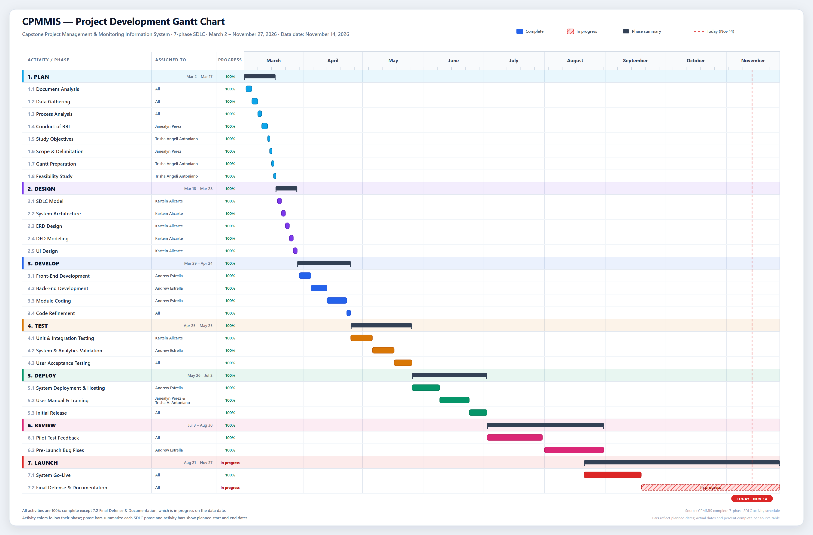

# CPMMIS — Project Gantt Chart

**System:** Capstone Project Management & Monitoring Information System (CPMMIS)  
**Schedule:** March 2 – November 27, 2026 · 7 phases · 27 activities  
**Data date:** November 14, 2026



**Files:** [SVG](cpmmis-gantt-chart.svg) · [PNG](cpmmis-gantt-chart.png) · [PDF](cpmmis-gantt-chart.pdf)  
**Generator:** [generate_gantt_chart.php](generate_gantt_chart.php)

---

## Gantt chart (Mermaid)

```mermaid
gantt
    title CPMMIS — 7-Phase SDLC Schedule (March 2 – November 27, 2026)
    dateFormat YYYY-MM-DD
    axisFormat %b %d
    todayMarker off

    section 1 · Plan (Mar 2–17)
    Document Analysis                 :done, p1a, 2026-03-03, 2026-03-05
    Data Gathering                    :done, p1b, 2026-03-06, 2026-03-08
    Process Analysis                  :done, p1c, 2026-03-09, 2026-03-10
    Conduct of RRL                    :done, p1d, 2026-03-11, 2026-03-13
    Study Objectives                  :done, p1e, 2026-03-14, 2026-03-14
    Scope & Delimitation              :done, p1f, 2026-03-15, 2026-03-15
    Gantt Preparation                 :done, p1g, 2026-03-16, 2026-03-16
    Feasibility Study                 :done, p1h, 2026-03-17, 2026-03-17

    section 2 · Design (Mar 18–28)
    SDLC Model                        :done, p2a, 2026-03-19, 2026-03-20
    System Architecture               :done, p2b, 2026-03-21, 2026-03-22
    ERD Design                        :done, p2c, 2026-03-23, 2026-03-24
    DFD Modeling                      :done, p2d, 2026-03-25, 2026-03-26
    UI Design                         :done, p2e, 2026-03-27, 2026-03-28

    section 3 · Develop (Mar 29–Apr 24)
    Front-End Development             :done, p3a, 2026-03-30, 2026-04-04
    Back-End Development              :done, p3b, 2026-04-05, 2026-04-12
    Module Coding                     :done, p3c, 2026-04-13, 2026-04-22
    Code Refinement                   :done, p3d, 2026-04-23, 2026-04-24

    section 4 · Test (Apr 25–May 25)
    Unit & Integration Testing        :done, p4a, 2026-04-25, 2026-05-05
    System & Analytics Validation     :done, p4b, 2026-05-06, 2026-05-16
    User Acceptance Testing           :done, p4c, 2026-05-17, 2026-05-25

    section 5 · Deploy (May 26–Jul 2)
    System Deployment & Hosting       :done, p5a, 2026-05-26, 2026-06-08
    User Manual & Training            :done, p5b, 2026-06-09, 2026-06-23
    Initial Release                   :done, p5c, 2026-06-24, 2026-07-02

    section 6 · Review (Jul 3–Aug 30)
    Pilot Test Feedback               :done, p6a, 2026-07-03, 2026-07-30
    Pre-Launch Bug Fixes              :done, p6b, 2026-08-01, 2026-08-30

    section 7 · Launch (Aug 21–Nov 27)
    System Go-Live                    :done, p7a, 2026-08-21, 2026-09-18
    Final Defense & Documentation     :active, p7b, 2026-09-19, 2026-11-27
```

---

## Phase summary

| Phase | Schedule | Activities | Assigned to |
|---|---|---:|---|
| **1. Plan** | Mar 2 – Mar 17, 2026 | 8 | All; Janealyn Perez; Trisha Angeli Antoniano |
| **2. Design** | Mar 18 – Mar 28, 2026 | 5 | Kartein Alicarte |
| **3. Develop** | Mar 29 – Apr 24, 2026 | 4 | Andrew Estrella; All |
| **4. Test** | Apr 25 – May 25, 2026 | 3 | Kartein Alicarte; Andrew Estrella; All |
| **5. Deploy** | May 26 – Jul 2, 2026 | 3 | Andrew Estrella; Janealyn Perez; Trisha Angeli Antoniano |
| **6. Review** | Jul 3 – Aug 30, 2026 | 2 | All; Andrew Estrella |
| **7. Launch** | Aug 21 – Nov 27, 2026 | 2 | All |
| **Total** | **Mar 2 – Nov 27, 2026** | **27** | **4 team members** |

## Status

- **26 of 27 activities are 100% complete.** Activity 7.2 (Final Defense & Documentation) is **in progress** on the November 14, 2026 data date.
- Phase 7 begins before Phase 6 finishes because 6.2 (Pre-Launch Bug Fixes) runs through **August 30** while 7.1 (System Go-Live) starts **August 21**, as scheduled in the source table.
- The Phase 6 summary bar is drawn through **August 30** so it covers activity 6.2. The source phase row lists August 20 as its end; the activity-level dates were treated as authoritative.

## Notes

- Source schedule: [cpmmis-project-schedule-table.md](cpmmis-project-schedule-table.md) (Phases 1–7).
- Print/PDF wrapper: [cpmmis-gantt-chart-print.html](cpmmis-gantt-chart-print.html) (A3 landscape).
- The alternative 32-week P0–P12 plan and its illustrative Gantt are in [cpmmis-schedule-feasibility.md](cpmmis-schedule-feasibility.md); this chart follows the 7-phase manuscript schedule with exact dates.
- Regenerate the SVG with:

```bash
php docs/generate_gantt_chart.php
```

- Render the PNG at 2× resolution with headless Chrome (or open the SVG in any browser and export):

```bash
chrome --headless=new --hide-scrollbars --force-device-scale-factor=2 \
  --window-size=1760,1160 \
  --screenshot=docs/cpmmis-gantt-chart.png \
  file:///path/to/docs/cpmmis-gantt-chart.svg
```
