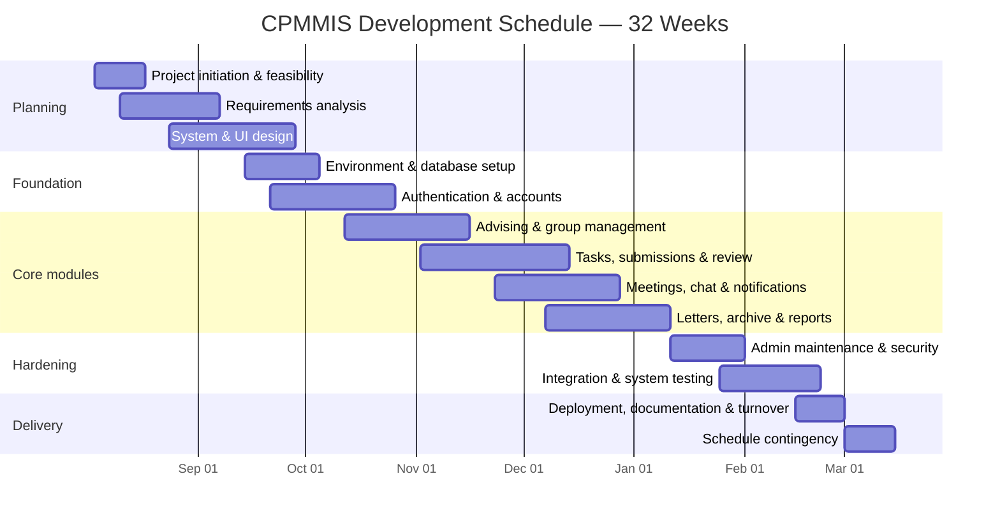

# CPMMIS — Schedule Feasibility

## Feasibility statement

**Rating: FEASIBLE.**

The CPMMIS scope can be delivered in approximately **30 weeks of planned work** within a
**32-week two-semester allotment**, leaving **two weeks of schedule contingency**. The
critical path runs through requirements, design, authentication, advising, submissions,
security hardening, integration testing, and deployment. The schedule is feasible provided
that the team has four members (or equivalent effort), the scope is frozen after design
sign-off, and the adviser/client reviews and user acceptance testing (UAT) happen on time.

## Planning assumptions

| Item | Assumption |
|---|---|
| Development window | 32 weeks (two semesters), excluding enrolment and examination weeks |
| Team | 4 members: project lead/analyst, two full-stack developers, one QA/documentation lead |
| Effort availability | Approximately 15 hours per member per week |
| Technology | PHP 8.x, MySQL/MariaDB, Laragon, Tailwind CSS, GitHub |
| Reviews | Adviser/client review every two weeks; milestone sign-off at the end of each phase |
| UAT participants | 1 administrator, 2 advisers, and 3 group leaders available in Weeks 27–29 |
| Scope | Current CPMMIS modules: accounts/OTP, advising, tasks/submissions, meetings, chat, notifications, letters, archive, reports, backup/maintenance |
| Change control | No major new modules after design sign-off; enhancements go to a post-deployment list |

## Work breakdown and schedule

| Phase | Weeks | Duration | Key deliverables | Depends on | Critical path |
|---|---|---|---|---|---|
| P0. Project initiation & feasibility | W1–W2 | 2 weeks | Proposal, feasibility study, team roles, initial scope | — | Yes |
| P1. Requirements analysis | W2–W5 | 4 weeks | SRS, use cases, DFD/ERD, acceptance criteria, review plan | P0 | Yes |
| P2. System and UI design | W4–W8 | 5 weeks | Architecture, database schema, wireframes, security design, API contracts | P1 | Yes |
| P3. Environment and database setup | W7–W9 | 3 weeks | Repository, Laragon environment, schema, migrations, seed data | P2 | Yes |
| P4. Authentication and account management | W8–W12 | 5 weeks | Registration, login, OTP/password reset, roles, sessions, account approval | P3 | Yes |
| P5. Advising and group management | W11–W15 | 5 weeks | Adviser requests, accept/decline, group profiles, adviser assignment | P4 | Yes |
| P6. Tasks, submissions, and review | W14–W19 | 6 weeks | Task creation, deadlines, PDF uploads, review/feedback, progress tracking | P5 | Yes |
| P7. Meetings, chat, and notifications | W17–W21 | 5 weeks | Meeting requests/decisions, chat, notifications, reminders | P6 | 3 weeks float |
| P8. Letters, archive, and reports | W19–W23 | 5 weeks | Admin letters, archive search, reports, analytics, activity/login logs | P6 | Yes |
| P9. Admin maintenance and security hardening | W24–W26 | 3 weeks | Backup/export, input validation, CSRF, rate limiting, access control | P7, P8 | Yes |
| P10. Integration and system testing | W26–W29 | 4 weeks | Integration tests, regression tests, security checks, UAT, bug fixing | P9 | Yes |
| P11. Deployment, documentation, and turnover | W29–W30 | 2 weeks | Production deployment, user manual, training, final defense materials | P10 | Yes |
| P12. Schedule contingency | W31–W32 | 2 weeks | Rework buffer, final sign-off, defense preparation | P11 | Buffer |

> Weeks overlap deliberately. Design starts while requirements are being finalized, and
> module development overlaps where dependencies allow. This is what keeps the 32-week
> schedule achievable. Overlapping phases are fast-tracked; the milestone gate still
> requires the predecessor's deliverables to be signed off.

## Gantt chart

The dates below are illustrative; shift them to the actual start of the capstone calendar.

## Critical path and milestones

The critical path is:

**P0 → P1 → P2 → P3 → P4 → P5 → P6 → P8 → P9 → P10 → P11**

The critical path consumes about **30 weeks**. P7 (meetings/chat/notifications) runs in
parallel with the later core modules and has about three weeks of float; P8
(letters/archive/reports) is on the critical path because P9 cannot start until it is
complete. Any delay beyond the available float must be absorbed by the two-week
contingency.

| Milestone | Target | Exit criterion |
|---|---|---|
| M1. Requirements sign-off | End of W5 | SRS, DFD/ERD, and acceptance criteria approved |
| M2. Design sign-off | End of W8 | Schema, architecture, UI flows, and security design approved |
| M3. Core modules complete | End of W19 | Auth, advising, tasks, and submissions working end-to-end |
| M4. Feature complete | End of W23 | Meetings, chat, notifications, letters, archive, and reports integrated |
| M5. Testing complete | End of W29 | Integration, regression, security, and UAT sign-off |
| M6. Deployment and turnover | End of W30 | Production deployment, user manual, and training completed |
| M7. Contingency/defense readiness | End of W32 | Final fixes, documentation, and defense rehearsal completed |

## Effort and resource feasibility

| Work area | Estimated effort |
|---|---:|
| Planning and requirements | 160 person-hours |
| Design and database | 200 person-hours |
| Core development (accounts, advising, submissions, meetings, chat, archive, reports) | 780 person-hours |
| Security and maintenance | 120 person-hours |
| Testing and UAT | 220 person-hours |
| Documentation and deployment | 160 person-hours |
| **Total estimated effort** | **1,640 person-hours** |

Available effort:

**4 members × 15 hours/week × 32 weeks = 1,920 person-hours**

This gives an estimated utilization of about **85%**, leaving roughly **280 person-hours
(15%)** for reviews, rework, and schedule contingency. A three-member team would have only
1,440 person-hours available, which is below the estimate; the team would need to work about
17–18 hours per week each or defer lower-priority features such as advanced analytics and
archive enhancements.

## Schedule risks and mitigations

| Risk | Likelihood | Impact | Mitigation |
|---|---|---|---|
| Scope creep from new feature requests | Medium | High | Freeze scope after M2; use a change-control log; defer enhancements to post-deployment |
| SMTP/OTP integration delay | Low | Medium | Configure Gmail app password early (W10); use logged/test OTP during development; test delivery before UAT |
| File-upload or storage limits | Medium | Medium | Validate PDF type/size early; test 10–20 MB files; confirm PHP upload limits before P6 |
| UAT participants unavailable | Medium | High | Book Weeks 27–29 in advance; provide asynchronous test scripts and a fallback reviewer |
| Chat/notification integration defects | Medium | Medium | Define API contracts in P2; test polling/heartbeat early; pair-review the integration |
| Team availability due to academic load | Medium | High | Maintain 15 hours/week baseline; cross-train members; track a weekly burndown |
| Deployment or hosting issues | Low | Medium | Deploy to staging in W29; prepare rollback steps and a backup before go-live |

## Schedule control

- Hold a weekly team stand-up and a biweekly adviser/client review.
- Track planned versus actual progress against the Gantt and milestone table.
- Protect the critical path: if a critical task slips by more than three days, reassign a
  developer from non-critical polish or archive work.
- Use the two-week contingency only for approved changes or critical-path recovery, not for
  ordinary delays.
- Keep documentation current from P1 onward so the final two weeks are for compilation and
  sign-off, not first drafts.

## Verdict and conditions

**The project is schedule-feasible within a 32-week, two-semester allotment.**

The schedule is feasible if:

1. The team has four members or equivalent effort.
2. Requirements and design are signed off by the end of Week 8.
3. The adviser/client reviews and UAT are held on schedule.
4. Gmail SMTP, hosting, and test accounts are available before deployment.
5. Scope changes after design sign-off are controlled and do not enter the critical path.

If the available window is **shorter than 26 weeks**, the full scope is not schedule-feasible
without descoping non-critical modules (for example, chat, advanced analytics, or archive
enhancements) or adding resources. A **30-week** window is possible but leaves no contingency
and should be treated as high-risk.
